# Frontend Audit — Cybersecurity Foundation (20-Session Course)

**Audit date:** 2026-11-12  
**Audit type:** Read-only frontend architecture, code quality, security, performance, accessibility, and testing review  
**Application:** Bilingual (English/Arabic, RTL) cybersecurity foundation course  
**Auditor role:** Senior Frontend Software Architect / Code Auditor  
**Scope:** `src/**`, `tests/**`, `index.html`, `package.json`, `tsconfig.json`, `vite.config.ts`, `README.md`  
**Out of scope:** Backend/API security (none exists), content factual accuracy, external link liveness, runtime browser/AT testing  
**Source changes:** **None.** No application source, test, or configuration file was modified.

> This is a **self-contained consolidation** of the full frontend audit. It replaces the previous multi-document set; every substantive finding, metric, evidence reference, recommendation, and limitation is retained here.

---

## Table of contents

1. [Executive summary](#1-executive-summary)
2. [Method and evidence](#2-method-and-evidence)
3. [Architecture](#3-architecture)
4. [Component inventory](#4-component-inventory)
5. [Routing and pages](#5-routing-and-pages)
6. [State and data flow](#6-state-and-data-flow)
7. [Design system](#7-design-system)
8. [Code quality](#8-code-quality)
9. [Security](#9-security)
10. [Performance and accessibility](#10-performance-and-accessibility)
11. [Testing](#11-testing)
12. [Consolidated findings register](#12-consolidated-findings-register)
13. [Implemented / partial / absent / unverifiable](#13-implemented--partial--absent--unverifiable)
14. [Risk analysis](#14-risk-analysis)
15. [Evaluation scorecard](#15-evaluation-scorecard)
16. [Improvement roadmap](#16-improvement-roadmap)
17. [Appendices](#17-appendices)
18. [Limitations and conclusion](#18-limitations-and-conclusion)

---

## 1. Executive summary

This is a **client-only, data-driven React 19 single-page application** that delivers a 20-session cybersecurity foundation course. It uses a hand-written hash router, one React Context store, localStorage persistence, and course content compiled directly into the bundle. It has **no backend, no API, no authentication, and no server-side state**.

The architecture fits its apparent distribution model: a portable, offline-capable course packaged as a single HTML file. The content model is unusually strong for a project of this size — bilingual data is modelled at the type level, curriculum structure is validated by tests, and all 20 sessions render server-side in both languages. TypeScript is configured strictly and passes type checking.

The audit found **no CRITICAL issues and no exploitable remote-code-execution or XSS path**. The two HIGH findings are:

1. **Dev-tooling dependency advisories** (Vite/esbuild) relevant to Windows development machines, not the shipped bundle.
2. **Core learning controls are not programmatically accessible**: quiz options, tick-offs, and toggles expose state only visually.

The remaining findings are MEDIUM/LOW polish, resilience, and verification gaps: unguarded localStorage, no error boundary or 404, silent loss of in-progress work on tab changes, a fixed exam question set, a large single bundle, broad context rerenders, missing interaction tests, incomplete UI localization, and a small chmod warning condition error.

### 1.1 Overall verdict

| Dimension | Rating | Summary |
|---|---|---|
| Architecture | **Good** | Clear content/state/view separation; right-sized for a static course |
| Maintainability | **Adequate** | Readable and typed, but two god modules, no lint/CI, duplicated UI strings |
| Correctness | **Adequate** | Core flows work; edge-case and one lab-copy defect |
| Type safety | **Good** | Strict TS, zero `any` in `src`, but tests excluded from `tsc` |
| Security | **Good** | No XSS sinks, secrets, or network; dev advisories remain |
| Privacy | **Excellent** | No analytics, cookies, third-party scripts, or remote assets |
| Performance | **Adequate** | No asset weight; ~737 KB JS and eager content/tools |
| Accessibility | **Needs work** | Semantic shell, but state semantics, labels, focus, and contrast gaps |
| Testing | **Adequate** | Strong content/SSR validation; no interaction/store/E2E/a11y tests |
| Design system | **Adequate** | Consistent visual language; no tokens or shared component library |
| Documentation | **Adequate** | Good README; several claims overstate what is implemented |

**Production readiness:** suitable as a self-study course. Not suitable as an assessable/credentialed course without server-side identity and scoring.

**No CRITICAL findings were identified.** The absence of a backend and the absence of unsafe HTML rendering remove the highest-risk frontend failure classes.

### 1.2 Key metrics

| Metric | Value |
|---|---|
| Sessions | 20, in 5 phases |
| Content modules | 10 files, two sessions each |
| Sections / objectives | 81 / 80 |
| Lab steps | 112 |
| Quiz questions | 139 |
| Homework tasks | 81 |
| References | 85 |
| Glossary terms | 150 (148 unique English terms) |
| Learning time declared | 1,290 minutes (~21.5 hours) |
| Lab tool IDs / components | 15 / 15 |
| Diagram kinds | flow, layers, cycle, grid |
| Routes | 5 page routes + 5 session tabs |
| React components | 33 |
| Automated tests | 154 passing in 2 files |
| Runtime dependencies | 4 (2 unused) |
| Estimated production JS | 736,813 B raw / 237,927 B gzip / 193,628 B brotli |
| Course content share of JS | ~472,725 B minified |
| Production dependency vulnerabilities | 0 (`npm audit --omit=dev`) |
| Dev-tooling vulnerabilities | 2 (1 high Vite, 1 low esbuild) |
| Source lines (src + tests) | ~3,050 |

> Bundle figures are an esbuild estimate mirroring the production JS, with CSS excluded. The actual `vite build` artifact was not produced during this audit to avoid writing build output.

### 1.3 Top findings at a glance

| ID | Severity | Finding | Evidence |
|---|---|---|---|
| H1 | **HIGH** | Vite dev-server dependency advisories on Windows; esbuild low advisory | `package.json:25`; `npm audit` |
| H2 | **HIGH** | Quiz options, tick-offs, phishing selections, and toggles lack accessible state/labels | `QuizRunner.tsx:42-64`; `SessionView.tsx:59-65`; `LabToolsA.tsx:85-96` |
| M1 | **MEDIUM** | localStorage reads/writes unguarded; progress not schema-validated | `store.tsx:33-54,88-96` |
| M2 | **MEDIUM** | No error boundary or 404; non-null phase assertion; fractional ids | `App.tsx:29-36`; `SessionView.tsx:71`; `router.ts:19-25` |
| M3 | **MEDIUM** | Tab switch unmounts and silently discards quiz/tool state | `SessionView.tsx:99-160`; `QuizRunner.tsx:16-17` |
| M4 | **MEDIUM** | Exam always uses quiz indices `[1,3]`; options never shuffled | `Pages.tsx:116` |
| M5 | **MEDIUM** | ~737 KB single JS bundle; all content/tools eager | `content/index.ts:2-13`; `SessionView.tsx:9-10`; `vite.config.ts:13` |
| M6 | **MEDIUM** | One context for language + progress causes broad rerenders | `store.tsx:63-84`; `App.tsx:9` |
| M7 | **MEDIUM** | No interaction/store/router/E2E/a11y tests; tests excluded from `tsc` | `tsconfig.json:30`; `tests/*` |
| M8 | **MEDIUM** | No lint, format, CI, or `test`/`typecheck` scripts | `package.json:6-10` |
| M9 | **MEDIUM** | Firewall/log tables and session footer can overflow on mobile | `LabToolsA.tsx:272-289`; `LabToolsB.tsx:267-280`; `SessionView.tsx:162` |
| M10 | **MEDIUM** | `text-slate-500` small text fails WCAG AA | 3.75:1 on slate-900; 4.24:1 on slate-950 |
| M11 | **MEDIUM** | UI localization incomplete despite “fully bilingual” claim | `Pages.tsx:54,62`; `LabToolsA.tsx:273`; `LabToolsB.tsx:165,268`; `App.tsx:24` |
| M12 | **MEDIUM** | Lab data and bilingual copy embedded inside components | `LabToolsA.tsx:29-36,70-78,248-262`; `LabToolsB.tsx:117-124,194-200` |
| L1 | LOW | “Everyone can read” chmod warning ignores the group-read bit | `LabToolsA.tsx:115` tests `b[6] && b[0]`; must also require `b[3]`. The `b[7]` world-writable check is correct. |

Full details, including L2–L17 and informational observations, are in [§12](#12-consolidated-findings-register).

---

## 2. Method and evidence

1. Read every file in `src/` and both test files.
2. Parsed all 20 content modules programmatically for structure and counts; sampled full sessions line-by-line.
3. Traced the boot/data flow: `index.html → main.tsx → App.tsx → pages/components → store/content`.
4. Ran `npx tsc --noEmit` → **pass**.
5. Ran `npx vitest run` → **154/154 pass**, 2 files, ~2.81 s.
6. Ran `npm audit --omit=dev` → **0 vulnerabilities**; `npm audit` → **2 dev vulnerabilities** (1 high, 1 low).
7. Estimated production JS with the installed esbuild: **736,813 B raw / 237,927 B gzip / 193,628 B brotli**, CSS excluded.
8. Computed WCAG contrast ratios for the recurring slate palette.
9. Cross-checked all cited line numbers against the files; corrected one initial misreading of the chmod bit layout (see L1).

**Evidence rules applied:** implemented / partial / absent / unverifiable are stated explicitly; no backend behavior is inferred; no secrets are reproduced; no destructive commands are run.

### 2.1 Commands and results

```text
$ npx tsc --noEmit
(exit 0, no output)

$ npx vitest run
Test Files  2 passed (2)
Tests       154 passed (154)
Duration    ~2.81s

$ npm audit --omit=dev
found 0 vulnerabilities

$ npm audit
2 vulnerabilities (1 low, 1 high)
```

No application source, tests, or configuration files were modified.

## 3. Architecture

### 3.1 System at a glance

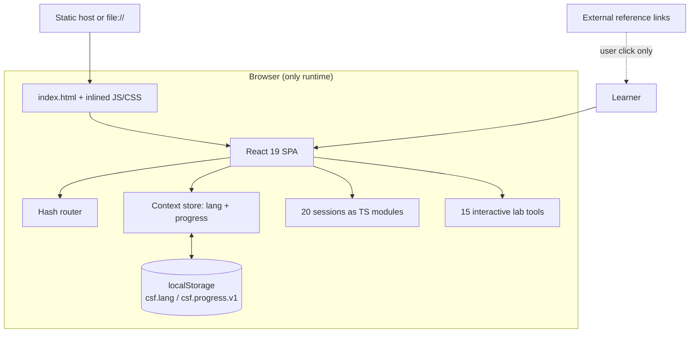

| Concern | Implementation |
|---|---|
| UI | React 19.2.6, function components + hooks |
| Language | TypeScript 5.9.3, `strict` |
| Build | Vite 7.3.2 + `@vitejs/plugin-react` 5.1.1 |
| Styling | Tailwind CSS 4.1.17 (CSS-first, no config file) |
| Packaging | `vite-plugin-singlefile` 2.3.0 |
| Tests | Vitest 4.1.12 + `renderToString` |
| Routing | Custom hash router |
| State | React Context + localStorage |
| Network | None at runtime |
| Auth | None |

### 3.2 Design intent supported by evidence

| Intent | Evidence |
|---|---|
| Portable/offline delivery | `vite-plugin-singlefile` (`vite.config.ts:13`); hash routing avoids server rewrites (`router.ts`); `sha256.ts:1` explicitly works on `file://` where `crypto.subtle` is unavailable |
| No network dependency | No `fetch`, `axios`, `XMLHttpRequest`, WebSocket, or `import.meta.env` anywhere in `src/` |
| Bilingual content as a first-class model | `L = {en, ar}` (`content/types.ts:1-3`); every session field uses `L` |
| Content validated at build/test time | `tests/content.test.ts` enforces structure, language presence, references, and exclusions |
| Minimal dependency surface | Runtime dependencies are only React, React DOM, and two unused utility libraries |

The architecture is intentionally small. For a 20-session static course, this avoids the operational overhead of a server, a CMS, and a client data-fetching library. The tradeoff is that every content change requires a rebuild, and every learner downloads the entire course.

### 3.3 Technology stack

| Concern | Choice | Version | Notes |
|---|---|---|---|
| UI runtime | React | 19.2.6 | Function components, hooks, StrictMode |
| DOM renderer | React DOM | 19.2.6 | `createRoot` |
| Language | TypeScript | 5.9.3 | `strict`, `noUnusedLocals`, `noUnusedParameters`, `noFallthroughCasesInSwitch` |
| Build/dev server | Vite | 7.3.2 | React plugin + Tailwind plugin + single-file plugin |
| React plugin | `@vitejs/plugin-react` | 5.1.1 | JSX transform / Fast Refresh |
| Styling | Tailwind CSS | 4.1.17 | CSS-first configuration via `@import "tailwindcss"` |
| Tailwind integration | `@tailwindcss/vite` | 4.1.17 | No `tailwind.config.*` file exists |
| Single-file packaging | `vite-plugin-singlefile` | 2.3.0 | Inlines assets into `dist/index.html` |
| Tests | Vitest | 4.1.12 | Node environment, `renderToString` |
| Unused classes helper | `clsx` + `tailwind-merge` | 2.1.1 / 3.4.0 | `src/utils/cn.ts` is never imported |
| Linting/formatting | — | — | No ESLint, Prettier, EditorConfig |
| CI | — | — | No CI configuration or git repository |

The package metadata is generic: `"name": "react-vite-tailwind"`, `"version": "0.0.0"`, no description, license, engines, or test/typecheck scripts (`package.json:1-29`).

### 3.4 Directory map

```
continue-cybersecurity-foundation-project/
├─ index.html                       HTML entry, root mount node, static metadata
├─ package.json                     scripts, runtime and dev dependencies
├─ package-lock.json                lockfile
├─ tsconfig.json                    strict TS config; includes src + vite.config only
├─ vite.config.ts                   React, Tailwind, single-file plugins; "@" alias
├─ README.md                        course and architecture overview
├─ src/
│  ├─ main.tsx                      React root, StrictMode, global CSS import
│  ├─ App.tsx                       Shell: header, nav, language switch, route outlet
│  ├─ router.ts                     Route union, hash parser, href builders, useRoute hook
│  ├─ store.tsx                     Context provider, progress model, persistence, status()
│  ├─ strings.ts                    Central bilingual UI string dictionary
│  ├─ index.css                     `@import "tailwindcss"` only
│  ├─ components/
│  │  ├─ SessionView.tsx            Session layout, tabs, lesson/lab/quiz/homework/refs
│  │  ├─ Pages.tsx                  SessionList, Home, Glossary, Exam
│  │  ├─ QuizRunner.tsx             Reusable quiz/exam engine
│  │  ├─ Diagram.tsx                Flow/layers/cycle/grid renderers
│  │  ├─ LabToolsA.tsx              Box/Btn/inp + 8 lab tools
│  │  └─ LabToolsB.tsx              7 lab tools; imports primitives from LabToolsA
│  ├─ content/
│  │  ├─ types.ts                   Session/Section/Diagram/Lab/Quiz/etc. interfaces
│  │  ├─ index.ts                   Eager imports and SESSIONS array
│  │  ├─ s01_02.ts … s19_20.ts      Ten files, two sessions each
│  ├─ lib/
│  │  └─ sha256.ts                  Custom SHA-256, Caesar cipher, password entropy
│  └─ utils/
│     └─ cn.ts                      clsx + tailwind-merge helper — unused
└─ tests/
   ├─ content.test.ts               Content/model/helper/router validation
   └─ render.test.tsx               SSR of every session × tab × language
```

### 3.5 Directory responsibilities

| Path | Responsibility | Coupling |
|---|---|---|
| `index.html` | Vite entry; `<div id="root">`; static English title; viewport meta | Only points to `src/main.tsx` |
| `src/main.tsx` | Mount React into root; import global CSS; StrictMode | Imports `App`, `index.css` |
| `src/App.tsx` | Shell layout and route selection; active nav; language switch | Imports content, SessionView, Pages, router, store, strings |
| `src/router.ts` | URL/hash ↔ route state; href builders | React only |
| `src/store.tsx` | Global language/progress state; localStorage; derived status | Imports content types only |
| `src/strings.ts` | All centralized UI strings as bilingual `L` values | Imports `l` from content types |
| `src/components/*` | Presentation and local interaction | Import store, strings, content types, lib |
| `src/content/types.ts` | Data contracts for the course | No UI imports |
| `src/content/*.ts` | Course data | Imports `l` and types only |
| `src/lib/sha256.ts` | Pure helpers for labs | No React imports |
| `src/utils/cn.ts` | Class-name merge helper | **Unused** |

### 3.6 Boot sequence

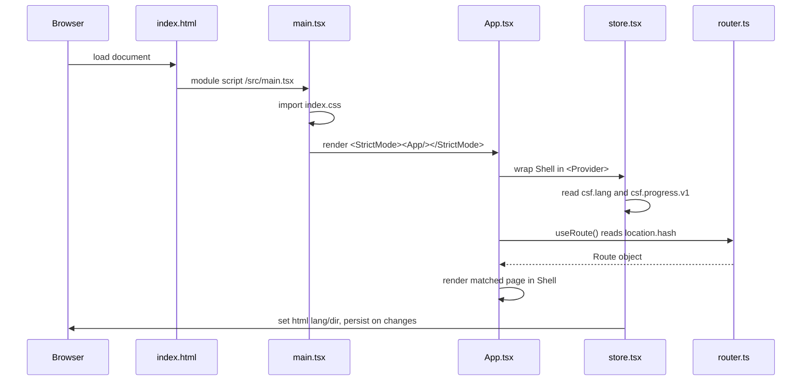

Key points:

- `main.tsx:6-10` mounts the app with `createRoot(document.getElementById("root")!)`.
- `App.tsx:42-48` wraps `Shell` in the store provider.
- `store.tsx:44-45` initializes language and progress from localStorage.
- `router.ts:36-47` subscribes to `hashchange` and scrolls to top on every route change.
- All routes share one layout (`Shell`); there are no nested layouts or per-route providers.

### 3.7 Module responsibilities and dependency graph

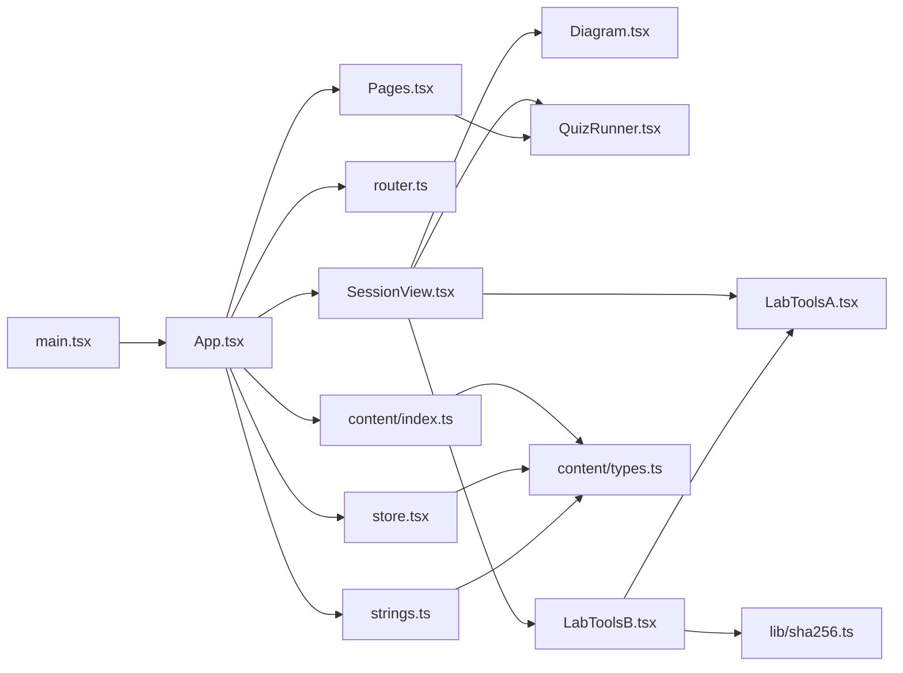

No module cycles exist. The only questionable edge is `LabToolsB → LabToolsA` for presentational primitives.

- **`App.tsx`** reads `lang`, `setLang`, `t` (`App.tsx:9`); reads the route (`App.tsx:10`); builds nav links and active state (`11-16`); applies the Arabic font stack (`18`); renders the sticky header, language switch, and route outlet (`19-37`); resolves sessions or a not-found message (`33-36`).
- **`router.ts`** defines the route union (`4-9`), tab whitelist (`11`), parser (`13-26`), href builders (`28-34`), and `useRoute` (`36-47`).
- **`store.tsx`** defines the progress model (`4-11`), context API (`17-29`), load/save (`33-54`), immutable updates (`56-84`), and derived status (`88-96`).
- **`strings.ts`** holds 50+ bilingual labels. A subset is unused: `diagram`, `tool`, `tasks`, `status`, `checkAnswers`, `view`, `ofLabel`, `all`.
- **`content/`** defines all interfaces (`types.ts:1-106`), eagerly assembles ten modules into `SESSIONS` (`index.ts:1-13`), and exports two strongly typed sessions per module.
- **`components/`** holds session layout, four pages, the quiz engine, four diagram renderers, and 15 lab tools.
- **`lib/sha256.ts`** provides dependency-free SHA-256 with FIPS 180-4 vectors (`18-50`), `passwordStats` (`52-60`), and `caesar` (`62-68`); no React or DOM dependencies.

### 3.8 Content model

```mermaid
classDiagram
  class Session {
    id: number
    phase: 1..5
    title: L
    summary: L
    minutes: number
    objectives: L[]
    sections: Section[]
    diagram: Diagram
    lab: Lab
    quiz: QuizQ[]
    homework: Homework
    refs: Ref[]
    terms: Term[]
  }
  class Section {
    h: L
    p: L[]
    bullets?: L[]
    callout?: {kind, text}
    table?: {head, rows}
  }
  class Diagram {
    kind: flow|layers|cycle|grid
    title: L
    caption: L
    nodes: DiagramNode[]
  }
  class Lab {
    title: L
    scenario: L
    safety: L
    steps: L[]
    expected: L
    tool: ToolId
    match?: MatchData
    order?: OrderData
  }
  class QuizQ {
    q: L
    options: L[]
    answer: number
    why: L
  }
  class Homework {
    title: L
    tasks: L[]
    deliverable: L
  }
  Session --> Section
  Session --> Diagram
  Session --> Lab
  Session --> QuizQ
  Session --> Homework
```

**Strengths**

- **Single source of truth** for content shape.
- **Exhaustive tool union** (`ToolId`, 15 values) lets TypeScript check the `LabTool` switch.
- **Bilingual by construction**: every learner-facing content string is `{en, ar}`.
- **Testable**: content can be validated without rendering.

**Weaknesses**

- `ToolId` couples content to UI implementation. Adding a tool requires editing the union, `SessionView` switch, a component, and content.
- Tool-specific data (CIA items, phishing parts, firewall rules, RBAC matrix, risk register, log sample) is **not** in the content model; it lives in components.
- `Ref.title` and `Ref.org` are plain strings, not `L`, so references are English-only by design.
- The session range `1..20` is not encoded in the type system; it is enforced by tests and duplicated in router/session header.

**Verified content metrics**

| Metric | Value |
|---|---|
| Sessions | 20 |
| Phases | 5 (4/4/4/5/3 sessions) |
| Sections | 81 |
| Objectives | 80 |
| Lab steps | 112 |
| Quiz questions | 139 |
| Homework tasks | 81 |
| References | 85 |
| Terms | 150 (148 unique English terms) |
| Declared minutes | 1,290 (~21.5 h) |
| Diagram kinds | flow 8, cycle 5, grid 4, layers 3 |

### 3.9 Build and packaging

`vite.config.ts:12-19` configures:

- `react()` — JSX transform and Fast Refresh.
- `tailwindcss()` — Tailwind v4 Vite integration.
- `viteSingleFile()` — inlines JS and CSS into one HTML file.
- `resolve.alias["@"]` — configured but unused; all imports are relative. `tsconfig.json` also defines `@/*`, and no code uses it.

**Benefits of single-file:** one distributable file; works from `file://`; trivial hosting; no separate asset requests; offline distribution; no CDN/font/image/analytics requests; strong privacy.

**Costs:** no route-level code splitting or per-chunk caching; every deploy re-downloads the entire app; all 20 sessions and 15 tools are parsed on first load; strict CSP is harder because scripts/styles are inlined; exact CSS output and final file size were not measured because the build was not run.

### 3.10 Architectural patterns and conventions

**Patterns in use:** data-driven UI; Provider/Context; custom hook (`useRoute`); exhaustive discriminated switch (`LabTool`); strategy-like tool selection; derived state (`status()`); optimistic best-score retention; single-file static build.

**Conventions:** PascalCase components; camelCase functions/variables; `use*` hooks; relative imports with explicit file names; no barrel files; inline Tailwind utilities; bilingual content via `l(en, ar)`; UI copy via `S`; default exports for pages/tools, named exports where a module holds several components.

**Anti-patterns / deviations:** presentational primitives (`Box`, `Btn`, `inp`) live in `LabToolsA`; content data embedded in components; repeated long class strings instead of variants or `cn`; magic numbers (`20` sessions, `40` exam questions, `0.7` pass, `25` completion weight, `[1,3]` quiz indices); non-null assertions and context null-casts in place of guards; index-based React keys for static lists (acceptable now, fragile if reordered).

### 3.11 Architecture strengths

1. **Appropriate technology for the problem.** No server, router library, state library, or HTTP client is needed for a static, local-first course.
2. **Clear module boundaries.** Content, state, routing, strings, helpers, and views are separated.
3. **Strong content model.** A single `Session` interface and bilingual `L` type make the curriculum consistent and testable.
4. **Small custom router.** Easy to understand, deep-linkable, no dependency risk.
5. **Offline/privacy posture.** No runtime network calls, third-party scripts, cookies, or analytics.
6. **Build-time validation.** Tests enforce curriculum completeness and bilingual presence.
7. **Strict TypeScript.** Compiler catches unused locals/parameters and fallthrough.
8. **Predictable state updates.** Immutable progress updates and best-score retention are simple to reason about.

### 3.12 Architecture weaknesses

1. **No error boundary or 404**, so a render error or bad URL has no graceful recovery.
2. **Single context for unrelated concerns**, causing broad rerenders and an interface-segregation violation.
3. **All content/tools eagerly bundled**, producing a large first load and no cache granularity.
4. **Content/UI coupling in lab tools**, making the content model incomplete and translations harder.
5. **Hardcoded session count and assessment constants**, requiring multi-file edits to extend the course.
6. **No service/repository abstraction** for persistence; localStorage calls are embedded in the provider.
7. **No formal design-system layer**, so visual consistency depends on discipline rather than tokens/components.
8. **Test architecture stops at SSR**, leaving interaction and state transitions unverified.
9. **No lint/CI**, so architectural conventions are not enforced automatically.
10. **Single-file build is the only build target**, forcing a portability/performance tradeoff on every consumer.

### 3.13 Architecture evidence index

| Claim | Evidence |
|---|---|
| React root + StrictMode | `src/main.tsx:6-10` |
| Provider wraps shell | `src/App.tsx:42-48` |
| Route switch | `src/App.tsx:29-36` |
| Hash parser and range | `src/router.ts:13-26` |
| Hash subscription cleanup | `src/router.ts:36-47` |
| Progress model | `src/store.tsx:4-11` |
| localStorage read/write | `src/store.tsx:33-54` |
| Best-score logic | `src/store.tsx:73-80` |
| Completion formula | `src/store.tsx:88-96` |
| Eager content imports | `src/content/index.ts:2-13` |
| Tool union | `src/content/types.ts:24-39` |
| Session interface | `src/content/types.ts:84-98` |
| Single-file plugin | `vite.config.ts:13` |
| Strict TS options | `tsconfig.json:25-28` |
| Tests excluded from TS | `tsconfig.json:30` |
| Unused class helper | `src/utils/cn.ts:1-6` (no importers) |
| Lab primitive dependency | `src/components/LabToolsB.tsx:4`; `LabToolsA.tsx:5-23` |

## 4. Component inventory

### 4.1 Summary

| Category | Count | Notes |
|---|---|---:|
| App shell | 1 | `Shell` + default `App` wrapper |
| Page-level components | 4 | Home, SessionList, Glossary, Exam |
| Session components | 4 | SessionView, SectionView, Check, LabTool dispatcher |
| Diagram components | 5 | Diagram + Flow, Layers, Cycle, Grid |
| Quiz components | 1 | QuizRunner, reused by session quizzes and exam |
| Lab primitives | 3 | Box, Btn, `inp` class constant |
| Lab tool components | 15 | One per `ToolId` value |
| **Total React components** | **33** | Excludes the `inp` string constant |
| Error boundary / fallback | 0 | Not implemented |
| Shared design-system components | 0 | No global Button/Card/Input/Table/Modal |

All components are function components. No class components, HOCs, render props, portals, or `React.memo` exist.

### 4.2 Core component inventory

| Component | File / lines | Props | Local state | Dependencies | Reuse |
|---|---|---|---|---|---|
| `App` (default) | `App.tsx:42-48` | none | none | `Provider`, `Shell` | One instance |
| `Shell` | `App.tsx:8-40` | none | none | `useApp`, `useRoute`, `SessionView`, `Pages`, `strings`, `content` | One instance |
| `SessionView` | `SessionView.tsx:68-169` | `{s: Session; tab: Tab}` | none (context + props) | `status`, `useApp`, `PHASES`, `SESSIONS`, `href`, `Diagram`, `QuizRunner`, 15 tools | One per session route |
| `SectionView` | `SessionView.tsx:32-57` | `{s: Section}` | none | `useApp` | Per lesson section |
| `LabTool` (dispatcher) | `SessionView.tsx:12-30` | `{lab: Lab}` | none | All 15 tool components | One per lab tab |
| `Check` | `SessionView.tsx:59-66` | `{on: boolean; onClick: () => void; children}` | none | None | Lab + homework rows |
| `SessionList` | `Pages.tsx:9-40` | none | none | `useApp`, `PHASES`, `SESSIONS`, `status`, `href`, `strings` | Sessions page + Home |
| `Home` | `Pages.tsx:42-83` | none | none | `useApp`, `SESSIONS`, `status`, `SessionList`, `href`, `PASS` | Home route |
| `Glossary` | `Pages.tsx:85-110` | none | `q: string` | `useApp`, `SESSIONS`, `useMemo`, `href` | Glossary route |
| `Exam` | `Pages.tsx:112-135` | none | `attempt: number \| null` | `useApp`, `SESSIONS`, `useMemo`, `QuizRunner` | Exam route |
| `QuizRunner` | `QuizRunner.tsx:6-100` | `{questions: (QuizQ & {tag?: string})[]; onDone(score,total): void; showSessionTag?: boolean}` | `ans: (number\|null)[]`, `done: boolean` | `useApp`, `PASS`, `strings` | Session quizzes + exam |
| `Diagram` | `Diagram.tsx:6-18` | `{d: Diagram}` | none | `useApp`, `Flow/Layers/Cycle/Grid` | Every lesson |
| `Flow` | `Diagram.tsx:20-40` | `{d: Diagram}` | none | `useApp` | `kind: "flow"` |
| `Layers` | `Diagram.tsx:42-63` | `{d: Diagram}` | none | `useApp` | `kind: "layers"` |
| `Cycle` | `Diagram.tsx:65-133` | `{d: Diagram}` | none | `useApp` | `kind: "cycle"` |
| `Grid` | `Diagram.tsx:135-147` | `{d: Diagram}` | none | `useApp` | `kind: "grid"` |

**Interface notes**

- `SessionView` receives the **whole** `Session` object; there is no selector or split into smaller data props. Simple call sites, but the view couples to the full model.
- `QuizRunner` is the most reusable interactive component: controlled by a `questions` array and an `onDone` callback, used by all 20 session quizzes and the 40-question exam.
- `Check` is a small presentational button but owns no state; the parent controls `on` and `onClick`.
- `SectionView` consumes context only to call `t()`. It could receive a translator or localized strings instead.
- `Diagram` subcomponents each call `t()` independently; only one is mounted at a time.

### 4.3 Lab primitives

| Export | File / lines | Signature | Purpose | Issues |
|---|---|---|---|---|
| `Box` | `LabToolsA.tsx:5-10` | `{title: string; children: ReactNode}` | Consistent lab card with gear heading | Header is English punctuation + title; title localized by caller |
| `Btn` | `LabToolsA.tsx:11-21` | `{children; onClick?; active?; disabled?}` | Lab button with active/disabled styles | No `type="button"` (no forms, currently safe); no `aria-pressed` |
| `inp` | `LabToolsA.tsx:22-23` | string constant | Shared input class string | Not a component; consumers must remember labels and focus behavior |

`LabToolsB` imports all three from `LabToolsA` (`LabToolsB.tsx:4`), creating an unintuitive feature-to-feature dependency and preventing primitive extraction without touching `A`.

### 4.4 Lab tool inventory

| Session | Tool ID | Component | File / lines | Local state | Key behavior |
|---:|---|---|---|---|---|
| 1 | `cia` | `CiaTool` | `LabToolsA.tsx:26-65` | `pick: (number\|null)[]` | Classify 6 incidents into C/I/A; immediate per-item feedback |
| 2 | `match` | `MatchTool` | `LabToolsA.tsx:308-333` | `pick: number[]`, `chk: boolean` | Match items to options; check reveals corrections |
| 3 | `match` | `MatchTool` | same | same | Reused with malware-family data |
| 4 | `phish` | `PhishTool` | `LabToolsA.tsx:68-105` | `sel: boolean[]`, `rev: boolean` | Select suspicious email parts; reveal analysis |
| 5 | `perm` | `PermTool` | `LabToolsA.tsx:108-139` | `b: boolean[9]` | chmod calculator; octal + symbolic output |
| 6 | `cidr` | `CidrTool` | `LabToolsA.tsx:148-192` | `ip`, `pre` | IPv4/CIDR calculations; private/loopback/link-local classification |
| 7 | `port` | `PortTool` | `LabToolsA.tsx:213-242` | `q`, `f` | Search/filter 16 common ports |
| 8 | `firewall` | `FirewallTool` | `LabToolsA.tsx:246-305` | `rules: Rule[]` | Reorder/edit first-match firewall rules to satisfy a policy |
| 9 | `cipher` | `CipherTool` | `LabToolsB.tsx:7-39` | `text`, `shift`, `dec`, `show` | Caesar encrypt/decrypt and 25-key brute force |
| 10 | `hash` | `HashTool` | `LabToolsB.tsx:42-71` | `a`, `b`, `exp` | SHA-256, avalanche difference, integrity check |
| 11 | `password` | `PasswordTool` | `LabToolsB.tsx:85-112` | `pw` | Entropy, pool size, offline crack-time estimate |
| 12 | `rbac` | `RbacTool` | `LabToolsB.tsx:115-156` | `m: number[][]`, `chk` | Cycle 4×4 access matrix; compare to policy |
| 13 | `sqli` | `SqliTool` | `LabToolsB.tsx:159-189` | `u`, `p` | Display-only vulnerable vs parameterized SQL demo |
| 14 | `order` | `OrderTool` | `LabToolsA.tsx:336-371` | `picks: number[]`, `chk` | Click items into correct order; deterministic shuffle |
| 15 | `risk` | `RiskTool` | `LabToolsB.tsx:192-230` | `r: {l,i,tx}[]` | Risk = likelihood × impact, sorted, treatment select |
| 16 | `logs` | `LogTool` | `LabToolsB.tsx:245-283` | `log: string`, `run: boolean` | Parse auth logs, summarize failures/success by IP |
| 17 | `order` | `OrderTool` | same | same | Reused for IR phase ordering |
| 18 | `match` | `MatchTool` | same | same | Reused for shared-responsibility matching |
| 19 | `match` | `MatchTool` | same | same | Reused for legal/ethical decisions |
| 20 | `order` | `OrderTool` | same | same | Reused for 90-day roadmap prioritization |

**Tool distribution:** 13 single-use tool components + 2 generic components reused across 7 sessions (`match` 4×, `order` 3×) = 15 `ToolId` values, 15 components.

### 4.5 Component dependency graph

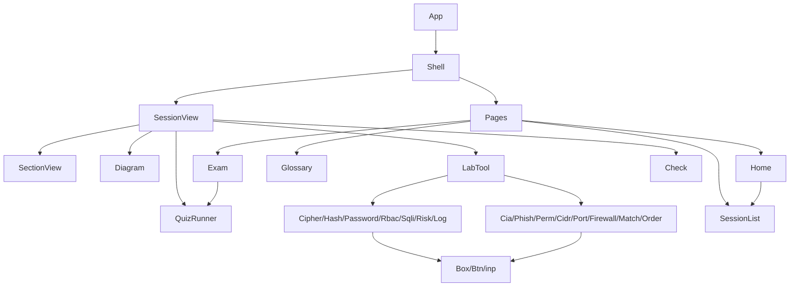

No circular dependencies. The only questionable edge is `LabToolsB → LabToolsA` for shared primitives.

### 4.6 Complexity and size

| File | Lines | Components | Assessment |
|---|---:|---:|---|
| `SessionView.tsx` | 169 | 4 | Largest view; five tab bodies inline; readable but dense |
| `Pages.tsx` | 136 | 4 | Four unrelated pages in one module; acceptable but should split |
| `LabToolsA.tsx` | 372 | 11 | **Oversized module**: 8 tools + 3 primitives |
| `LabToolsB.tsx` | 284 | 7 | **Oversized module**: 7 tools |
| `Diagram.tsx` | 148 | 5 | Cohesive; four renderers in one module is reasonable |
| `QuizRunner.tsx` | 100 | 1 | Focused and reusable |
| `App.tsx` | 49 | 2 | Focused shell |

**Largest individual tool functions:** `FirewallTool` (~60 lines), `CidrTool` (~45), `RiskTool` (~39), `RbacTool` (~42), `LogTool` (~39). None is extreme, but they combine data definitions, derived calculations, and JSX in one function.

**Long-line readability:** `SessionView.tsx:94,118`, `Pages.tsx:62`, and `LabToolsA.tsx:115` contain very long JSX/ternary lines that are hard to review.

**Nested ternaries:** `QuizRunner.tsx:51-59` selects one of four class strings via nested ternaries; `Pages.tsx` uses repeated conditional templates. A `cn` helper exists but is unused.

### 4.7 State ownership

| Owner | State | Persistence |
|---|---|---|
| `Provider` (`store.tsx`) | `lang`, `progress` | localStorage (`csf.lang`, `csf.progress.v1`) |
| `Glossary` | search query `q` | none |
| `Exam` | `attempt` seed | none |
| `QuizRunner` | answers, submitted flag | Best score only, via `onDone` |
| Each lab tool | Tool-specific selections/inputs | none |
| `router.useRoute` | current parsed route | URL hash |

No component owns server state because no server state exists.

### 4.8 Duplication analysis

**Repeated styling**

- Card surface: `rounded-2xl border border-slate-800 bg-slate-900/60` appears in `Pages.tsx`, `SessionView.tsx`, `QuizRunner.tsx`, `Diagram.tsx`.
- Primary button: `rounded-lg bg-emerald-500 px-4/5 py-2 font-semibold text-slate-950` appears in `SessionView`, `QuizRunner`, `Pages`.
- Secondary button: `rounded-lg border border-slate-600 px-4 py-2 text-slate-200 hover:bg-slate-800` appears in `QuizRunner`, `Pages`, tools.
- Progress track: `h-1.5/h-2/h-3 overflow-hidden rounded-full bg-slate-800` plus inner emerald fill appears in `SessionList`, `Home`, `SessionView`, and `PasswordTool`.

**Repeated feedback logic**

- Correct/incorrect messages: `CiaTool` (`LabToolsA.tsx:51-55`), `MatchTool` (`322-323`), `OrderTool` (`356-367`), `QuizRunner` (`67-73`).
- Score summaries: `CiaTool` (`60-62`), `PhishTool` (`101`), `MatchTool` (`329`), `OrderTool` (`367`), `QuizRunner` (`88-90`).
- “Check” and “Reset” button pairs: `MatchTool`, `OrderTool`, `RbacTool`, `PhishTool`.

**Repeated bilingual literals:** tools use `tr(en, ar)` with inline pairs across 13 components, duplicating the approach of `strings.ts` and the content `L` model and preventing extraction/linting.

**Repeated data definitions:** `CiaTool.items` (`29-34`), `PhishTool.parts` (`70-78`), `PermTool.who/what` (`111-112`), `PORTS` (`195-212`, good: outside component), firewall rules/packets (`248-262`), RBAC data (`LabToolsB.tsx:117-124`), risk register (`194-200`), log sample (`233-244`, good: outside component).

**Recommendation:** introduce `Card`, `Button` (primary/secondary/ghost/danger), `ProgressBar`, `Badge`, `Callout`, `Field`, `ResultBadge`, `ScoreSummary`, `CheckActions`, `DataTable`, and `LabShell` components; move tool copy/data into typed content modules.

### 4.9 Reuse opportunities

| Opportunity | Current duplication | Proposed abstraction |
|---|---|---|
| Button variants | 20+ inline class strings | `Button` with `variant`, `size`, `active`, `disabled` |
| Card/panel | 15+ repeated surfaces | `Card` / `Panel` |
| Progress bar | 4 implementations | `ProgressBar` with label, value, accessible role |
| Result badge | 5 implementations | `ResultBadge` with `correct`, `score`, `label` |
| Lab shell | 15 tool wrappers | `LabShell` standardizing `Box`, instructions, reset |
| Table wrapper | Lesson/port/RBAC wrapped; firewall/log not | `DataTable` with responsive scroll and `<caption>` |
| Field/label | Ad hoc inputs | `Field` with `<label>`, hint, error, `aria-describedby` |
| Score actions | Check/reset pairs | `CheckActions` |
| Section block | Paragraph/bullets/table/callout logic | Keep `SectionView`; extract `Callout`, `ContentTable` |
| Tool data | Embedded arrays | `ToolData` typed modules |

### 4.10 Component-level findings

| ID | Severity | Finding | Evidence | Recommendation |
|---|---|---|---|---|
| C1 | HIGH | Quiz/checkbox/phishing state not programmatically exposed | `QuizRunner.tsx:42-64`; `SessionView.tsx:59-65`; `LabToolsA.tsx:85-96` | Radio semantics or `aria-pressed`; announce results |
| C2 | LOW | “Everyone can read” warning omits the group-read bit | `LabToolsA.tsx:115` uses `b[6] && b[0]` but needs `b[0] && b[3] && b[6]` | Fix condition; unit-test 640/604/444/777 |
| C3 | MEDIUM | Tab switch unmounts quiz/tool state | `SessionView.tsx:99-160`; `QuizRunner.tsx:16-17` | Lift/persist state or warn |
| C4 | MEDIUM | 15 tools eagerly imported; two god modules | `SessionView.tsx:9-10`; `LabToolsA.tsx`; `LabToolsB.tsx` | Per-tool modules + lazy loading |
| C5 | MEDIUM | Tool data/copy embedded in components | Lines listed in §4.8 | Move to content modules |
| C6 | LOW | Repeated class strings despite `cn` being available | `utils/cn.ts` unused | Adopt `cn` + UI variants |
| C7 | LOW | `Check`/`Btn` lack `aria-pressed` for toggle behavior | `SessionView.tsx:59-65`; `LabToolsA.tsx:11-21` | Add state semantics |
| C8 | LOW | Index keys in static lists | `Pages.tsx:98`; `SessionView.tsx:105,110`; tool lists | Stable IDs if lists become dynamic |
| C9 | LOW | `Pages.tsx` exports four unrelated pages | `Pages.tsx:9,42,85,112` | Split into `pages/` files |
| C10 | INFO | No `React.memo`; `useCallback` only once | `store.tsx:56`; no memo usage | Optimize after splitting contexts |

**Evidence index:** hierarchy (`App.tsx:42-48`; `SessionView.tsx:9-10,68`); quiz reuse (`SessionView.tsx:139`; `Pages.tsx:131`); tool dispatch (`SessionView.tsx:12-30`); primitives (`LabToolsA.tsx:5-23`; `LabToolsB.tsx:4`); embedded tool data (`LabToolsA.tsx:29-36,70-78,248-262`; `LabToolsB.tsx:117-124,194-200`); repeated styling (`Pages.tsx:20`; `SessionView.tsx:80`; `QuizRunner.tsx:35`); unused `cn` (`src/utils/cn.ts:1-6`, zero importers).

## 5. Routing and pages

### 5.1 Router design

The app uses a **custom hash router** in `src/router.ts` (48 lines). There is no React Router, TanStack Router, wouter, or history library.

```ts
type Tab = "lesson" | "lab" | "quiz" | "homework" | "refs";

type Route =
  | { page: "home" }
  | { page: "sessions" }
  | { page: "glossary" }
  | { page: "exam" }
  | { page: "session"; id: number; tab: Tab };
```

Evidence: `router.ts:3-9`.

### 5.2 Parsing algorithm

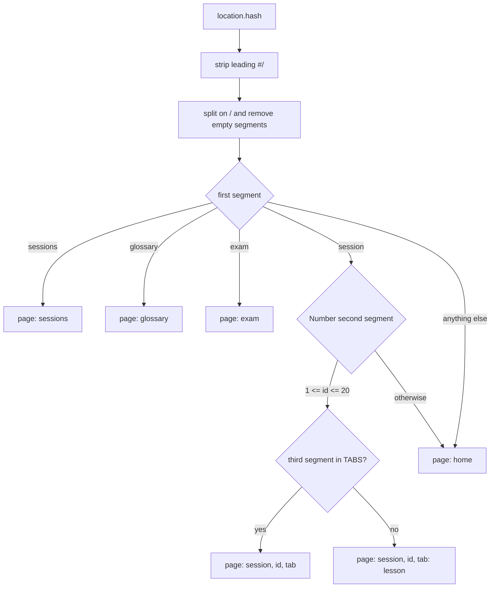

Evidence: `router.ts:13-26`.

Key behaviors:

- Empty hash / `#/` → home.
- Unknown top-level path → home, **not** a 404.
- `#/session/:id` with valid id but no tab → lesson.
- Invalid tab → lesson.
- Out-of-range or non-numeric id → home.
- **Fractional numeric ids are accepted** because there is no `Number.isInteger` check. `#/session/5.5` creates a session route that cannot resolve, producing “Session not found.” at `App.tsx:34-35`.
- Extra path segments are ignored (e.g., `#/session/5/lab/extra`).
- Numeric strings such as `"0x5"`, `"5e0"`, and `"05"` parse to a valid id where `Number()` yields 5.

### 5.3 Href builders and `useRoute`

```ts
export const href = {
  home: "#/",
  sessions: "#/sessions",
  glossary: "#/glossary",
  exam: "#/exam",
  session: (id, tab = "lesson") => `#/session/${id}/${tab}`,
};
```

Evidence: `router.ts:28-34`.

All navigation is plain `<a href="...">`. There is no `Link` component, click interception, or prefetching. Browser hash changes trigger `hashchange`, and `useRoute` updates React state.

- Initial state: `parse(location.hash)` (`router.ts:37`).
- `hashchange` listener parses and sets state, then `window.scrollTo({ top: 0 })` (`router.ts:38-45`).
- Cleanup removes the listener.
- Scroll position is **not** restored on back/forward; every hash change scrolls to top.

**Strengths:** no dependency; auditable; deep-linkable; works from `file://` and static hosts without rewrites; back/forward via native hash history; invalid input normalized rather than crashing.

**Weaknesses:** no 404 route; invalid URLs silently show Home without correcting the URL; no integer validation; session count `20` hardcoded (`router.ts:20`); invalid tabs silently rewritten at render time while the URL still shows the invalid tab; no route metadata; no focus management or screen-reader announcement; always scrolls to top, including back navigation; no typed href validation.

### 5.4 Route table

| Hash pattern | Route object | Rendered component | Layout | Purpose |
|---|---|---|---|---|
| `#/` or empty | `{page:"home"}` | `Home` | Shell | Dashboard, hero, overall progress, next session, reset |
| `#/sessions` | `{page:"sessions"}` | `SessionList` | Shell | All 20 sessions grouped into 5 phases |
| `#/glossary` | `{page:"glossary"}` | `Glossary` | Shell | Searchable bilingual glossary |
| `#/exam` | `{page:"exam"}` | `Exam` | Shell | 40-question final exam |
| `#/session/:id/lesson` | `{page:"session",id,tab:"lesson"}` | `SessionView` | Shell | Objectives, sections, diagram, key terms, mark-read |
| `#/session/:id/lab` | `...tab:"lab"` | `SessionView` | Shell | Scenario, safety, interactive tool, steps, expected outcome |
| `#/session/:id/quiz` | `...tab:"quiz"` | `SessionView` | Shell | Session quiz with feedback and best score |
| `#/session/:id/homework` | `...tab:"homework"` | `SessionView` | Shell | Tasks, tick-off, deliverable |
| `#/session/:id/refs` | `...tab:"refs"` | `SessionView` | Shell | External references |
| anything else | `{page:"home"}` | `Home` | Shell | Fallback, no 404 |

There are **no protected routes**, **no auth guards**, **no nested route layouts**, and **no route-level code splitting**.

### 5.5 Page-by-page analysis

#### Home (`#/`) — `Pages.tsx:42-83`

**Purpose:** course entry point and progress dashboard.

**Content:** hero with static English eyebrow “CYBERSECURITY · FOUNDATION” (`Pages.tsx:54`), course name, tagline; primary CTA to the next incomplete session, or session 1 if all complete (`48,58`); secondary CTA to the exam (`59`); four stats (`61-65`); overall progress bar and completed count (`68-73`); exam best score if present (`72`); full `SessionList` (`75`); scope note and global reset with native `confirm()` (`77-80`).

**Data flow:** reads `t`, `tr`, `progress`, `reset`; computes `pcts`, `overall`, `done`, `nextS`, `hours` on every render. Calls `status()` repeatedly for the same sessions (also called again inside `SessionList`).

**Issues:** stats `<dd>` precedes `<dt>` (`63`), reversing definition-list semantics; progress bar is a `div` with no `role="progressbar"` or ARIA values; reset uses blocking native confirm and offers no per-session reset; “Continue” after all sessions complete points to session 1; hardcoded English eyebrow and `~22h` break full localization. The quiz stat uses `${total * 5}+` = “100+”, while the actual total is 139; learning time is `Math.round(1290 / 60)` = “~22h” with a Latin `h` even in Arabic.

#### Sessions list (`#/sessions`) — `Pages.tsx:9-40`

**Purpose:** browse the curriculum by phase.

**Content:** iterates `PHASES` (`13`), filters `SESSIONS` by phase (`17`), renders a two-column grid on `md`; each card links to the lesson tab (`20`); card shows session number or checkmark at 100%, title, summary, progress bar, percentage, minutes (`22-28`).

**Data flow:** reads `t`, `progress`; calls `status(progress, s)` per session.

**Issues:** progress bar lacks accessible semantics (numeric text mitigates); checkmark replaces the session number, so completed cards lose their number; `line-clamp-2` truncates summaries visually (DOM text remains complete); `text-[11px] text-slate-500` metadata fails AA contrast; cards are anchors containing headings — valid, but no `aria-current`.

#### Glossary (`#/glossary`) — `Pages.tsx:85-110`

**Purpose:** searchable aggregation of all session key terms.

**Content:** `useMemo` flattens all terms, attaches `sid`, sorts by localized term with `localeCompare` (`88-91`); filter matches localized term + definition + English term (`92`); search input with placeholder only (`96`); two-column definition list linking to sessions (`97-107`); in Arabic mode shows the English term inline with `dir="ltr"` (`101`).

**Data flow:** local `q`; no persistence.

**Issues:** search cannot match English definitions in Arabic mode (only localized term/definition plus English term); input has no `<label>`/`aria-label`; duplicate terms are not merged (150 entries, 148 unique English terms; “Vulnerability” and “Compliance” appear twice with different session links); `useMemo` depends only on `lang` (correct while content is static, stale if dynamic); no empty-state message; no debounce (fine for 150 terms).

#### Exam (`#/exam`) — `Pages.tsx:112-135`

**Purpose:** 40-question final assessment with a 70% pass mark.

**Content:** intro screen with description and start button (`126-129`); start sets `attempt = Date.now() % 1000` (`128`); `useMemo` builds the pool from quiz indices `[1, 3]` of every session, tags each with `S{id}`, and performs a seeded Fisher–Yates shuffle using an LCG (`115-121`); renders `QuizRunner` with `key={attempt}`, `showSessionTag`, and `onDone={saveExam}` (`131`).

**Data flow:** local `attempt`; best score persisted through `saveExam`.

**Issues:** **fixed question set** — exactly the second and fourth quiz question from every session (40 total), so every attempt tests the same content, only order changes; options are never shuffled, so answer positions are stable; “Try again” inside `QuizRunner` reuses the same order, and a new seed requires leaving and re-entering the route; no prior best score or pass status on the intro; no confirmation before leaving an active exam; no timer (not claimed); no per-attempt history.

#### Session view (`#/session/:id/:tab`) — `SessionView.tsx:68-169`

**Header:** session number / 20 and phase title (`81`); title, summary, minutes badge, percentage badge, progress bar (`82-88`).

**Tab navigation:** five anchors — lesson, lab, quiz, homework, refs (`72,91-97`); active tab styled with emerald background; completed tabs show a checkmark; no `aria-current`; no role tablist/tabpanel (links are acceptable for URL navigation, but state should still be announced).

**Lesson tab (`99-120`):** objectives card; all sections via `SectionView` (heading, paragraphs, optional bullets, optional scrollable table, optional callout); diagram; key terms grid; mark-read/unread button.

**Lab tab (`122-134`):** lab title, scenario, safety notice; `LabTool` dispatch; tick-off steps with `Check`; expected outcome.

**Quiz tab (`136-141`):** best score if present; `QuizRunner` with session questions; save on submit.

**Homework tab (`143-149`):** tasks with `Check`; deliverable callout.

**Refs tab (`151-160`):** external links with `target="_blank"` and `rel="noopener noreferrer"`, org, URL.

**Footer (`162-165`):** previous session (or empty span), next session or final exam link.

**Issues:** tab switch unmounts the current tab and loses unsubmitted quiz answers and all tool state; session number `/20` hardcoded; `PHASES.find(...)!` can crash on invalid content; footer lacks `flex-wrap`, so long Arabic labels can overflow narrow screens; prev/next arrows are not RTL-aware; progress bar lacks ARIA semantics; lesson mark-read toggles without confirmation (acceptable); ref titles/orgs are English-only and not marked `lang="en"` in Arabic mode.

### 5.6 Navigation structure

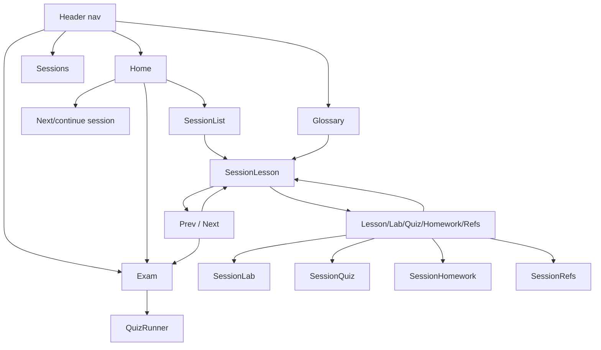

Active navigation: Home nav active only on `home`; Sessions nav active on `sessions` and any `session` page (`App.tsx:13`); Glossary and Exam active on their routes; no `aria-current="page"`.

### 5.7 Route parameters, auth, and missing routes

| Parameter | Source | Validation | Notes |
|---|---|---|---|
| `id` | second hash segment | `Number(id)` and `>=1 && <=20` | Not integer-checked; `SESSIONS.find` may fail for fractions |
| `tab` | third hash segment | membership in `TABS` | Invalid values silently become `lesson` |
| Query string | none | — | Not parsed |
| Hash fragment | none | — | Not used |

**Authentication and route protection: not implemented.** There are no login/registration routes, auth context or token storage, route guards or redirects, role checks, logout behavior, or protected pages. Every route is public. Learning progress is local and editable; it is not an authorization boundary.

**Missing routes:** no 404/NotFound, no settings/profile/progress-export, no per-term glossary detail, no reset-confirmation modal route, no phase-filter route (phases are sections on the sessions page).

**Unreachable/edge cases:** “Session not found.” (`App.tsx:35`) is reachable only via a fractional id such as `#/session/5.5`, because non-numeric and out-of-range ids fall back to home; an invalid tab URL renders the lesson but leaves the invalid tab in the address bar; extra path segments are ignored, not rejected.

### 5.8 Routing recommendations

| Priority | Recommendation | Evidence |
|---|---|---|
| P1 | Add a real 404 route and stop rewriting unknown URLs silently | `router.ts:25` |
| P1 | Require `Number.isInteger(id)` and constrain ids to the actual session list | `router.ts:19-23` |
| P1 | Centralize `TOTAL_SESSIONS` and derive `/20`, range checks, and tests from it | `router.ts:20`; `SessionView.tsx:81` |
| P1 | Add `aria-current="page"` to active nav/tabs | `App.tsx:23`; `SessionView.tsx:93` |
| P1 | Move focus to the new page heading and announce route changes | `router.ts:38-45` |
| P2 | Add route metadata and update `document.title` per route/language | `index.html:6` |
| P2 | Preserve quiz/tool state across tab switches, or warn before leaving dirty state | `SessionView.tsx:99-160` |
| P2 | Shuffle the full exam pool and options; offer a fresh shuffle on retry | `Pages.tsx:116-120` |
| P3 | Add scroll restoration for back/forward navigation | `router.ts:41` |
| P3 | Consider `/sessions/:phase` or query filters if the curriculum grows | `Pages.tsx:13-17` |

## 6. State and data flow

### 6.1 State inventory

| State | Owner | Mechanism | Lifetime | Persisted |
|---|---|---|---|---|
| Current route | `useRoute` in `router.ts` | `useState` + `hashchange` | Session | URL hash |
| Language (`en`/`ar`) | `Provider` | `useState` | App lifetime | `localStorage["csf.lang"]` |
| Progress | `Provider` | `useState` | App lifetime | `localStorage["csf.progress.v1"]` |
| Glossary query | `Glossary` | `useState` | Mount | No |
| Exam attempt seed | `Exam` | `useState` | Mount | No |
| Quiz answers | `QuizRunner` | `useState` | Mount | Best score only |
| Quiz submitted flag | `QuizRunner` | `useState` | Mount | No |
| Lab tool inputs/selections | Each tool | `useState` | Mount | No |
| Tool check/reveal flags | `MatchTool`, `OrderTool`, `RbacTool`, `PhishTool` | `useState` | Mount | No |

No external state library, reducer, query cache, observable store, or cross-tab synchronization exists.

### 6.2 Context API

```ts
interface Ctx {
  lang: Lang;
  setLang: (l: Lang) => void;
  t: (x: L) => string;
  tr: (en: string, ar: string) => string;
  progress: Progress;
  setRead: (id: number, v: boolean) => void;
  toggleLab: (id: number, i: number, n: number) => void;
  toggleHw: (id: number, i: number, n: number) => void;
  saveQuiz: (id: number, score: number, total: number) => void;
  saveExam: (score: number, total: number) => void;
  reset: () => void;
}
```

Evidence: `store.tsx:17-29`.

Implementation details:

- Context default is `null as unknown as Ctx` (`store.tsx:30`), and `useApp` is a bare `useContext` (`31`). Rendering a consumer outside `Provider` produces a runtime null-access error rather than a clear diagnostic.
- The provider value is memoized on `[lang, progress, setLang]` (`63-84`).
- `setLang` is wrapped in `useCallback` (`56`) even though `setLangState` is already stable.
- `t` and `tr` close over `lang`; update functions use functional `setProgress` and are recreated with each value memo.
- Because the context is monolithic, any consumer of `t` also subscribes to progress changes, and vice versa.

### 6.3 Progress data model

```ts
interface Progress {
  read: Record<number, boolean>;
  lab: Record<number, boolean[]>;
  hw: Record<number, boolean[]>;
  quiz: Record<number, { score: number; total: number }>;
  exam?: { score: number; total: number };
}
```

Evidence: `store.tsx:4-10`.

Example stored JSON:

```json
{
  "read": { "1": true, "2": true },
  "lab": { "1": [true, true, true, true, true, true] },
  "hw": { "1": [true, false, false, false] },
  "quiz": { "1": { "score": 5, "total": 6 } },
  "exam": { "score": 31, "total": 40 }
}
```

Keys become strings through JSON serialization; numeric access (`progress.lab[s.id]`) still works due to JS property coercion.

### 6.4 Completion and status derivation

```ts
export function status(p: Progress, s: Session) {
  const lab = (p.lab[s.id] ?? []).filter(Boolean).length / s.lab.steps.length;
  const hw = (p.hw[s.id] ?? []).filter(Boolean).length / s.homework.tasks.length;
  const q = p.quiz[s.id];
  const quizPass = !!q && q.score / q.total >= PASS;
  const read = !!p.read[s.id];
  const pct = Math.round(((read ? 1 : 0) + lab + hw + (quizPass ? 1 : 0)) * 25);
  return { read, lab, hw, quizPass, quizScore: q, pct };
}
```

Evidence: `store.tsx:88-96`; `PASS = 0.7` (`store.tsx:15`).

Semantics: four equally weighted components, 25 points each; lab and homework fractional by ticked steps/tasks; 100 only when all four are complete; quiz pass uses the **best** saved score, not the latest; quiz percentage is not rounded per component, only the final pct.

Edge cases: if `s.lab.steps` or `s.homework.tasks` is empty, division yields `NaN` (current content prevents this and tests enforce minimums); stored arrays longer than current content can produce >100%; malformed nested fields can throw on property access; no partial credit for a quiz below the pass threshold (69% contributes 0).

### 6.5 Persistence

| Key | Value | Written by |
|---|---|---|
| `csf.lang` | `"en"` or `"ar"` | Language effect (`store.tsx:47-51`) |
| `csf.progress.v1` | JSON progress object | Progress effect (`store.tsx:52-54`) |

**Load path** (`store.tsx:33-41`):

```ts
function load(): Progress {
  try {
    const raw = localStorage.getItem(KEY);
    if (raw) return { ...EMPTY, ...JSON.parse(raw) };
  } catch {
    /* ignore */
  }
  return EMPTY;
}
```

- Only `getItem` and JSON parsing are guarded.
- The merge is **shallow**; a stored `{ read: null }` overrides the default `{}`.
- There is no version field, schema validation, migration, or type guard.
- `EMPTY` is a module-level object reused by reset (`11,81`). Updates create new objects, so no mutation occurs.

**Write path**

- `document.documentElement.lang/dir` updated, then `localStorage.setItem(LKEY, lang)` (`47-51`).
- Full progress JSON serialized on every progress change (`52-54`).
- Neither write is wrapped in try/catch. A `SecurityError` or `QuotaExceededError` becomes an uncaught effect error.
- Writes are synchronous on every checkbox click; the payload is small (typically <10 KB).
- No debounce, no `storage` event listener, no cross-tab merge.
- Reset writes an empty progress object on the next effect; it does not remove the key.

**Initial language read:** `useState<Lang>(() => (localStorage.getItem(LKEY) === "ar" ? "ar" : "en"))` (`44`). Unguarded — where storage access throws, the app fails during initialization. The document language/direction is applied in an effect, so the first paint uses static `lang="en"` from `index.html` until the effect runs.

### 6.6 Mutation flows

#### Lesson read toggle

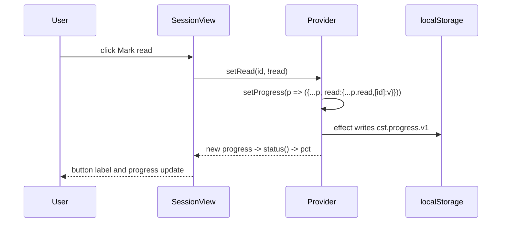

#### Lab/homework tick-off

- `toggleLab(id, i, n)` / `toggleHw(id, i, n)` call `toggleArr` (`store.tsx:57-61`).
- `toggleArr` copies the array for the session or creates `Array(n).fill(false)`, flips index `i`, and returns a new record.
- The parent passes the current step count on each click (`SessionView.tsx:130,146`).
- If content changes length between sessions, stale arrays can mismatch the new step count.
- Tool success is **not** connected to step checkboxes; learners tick steps manually.

#### Quiz submission

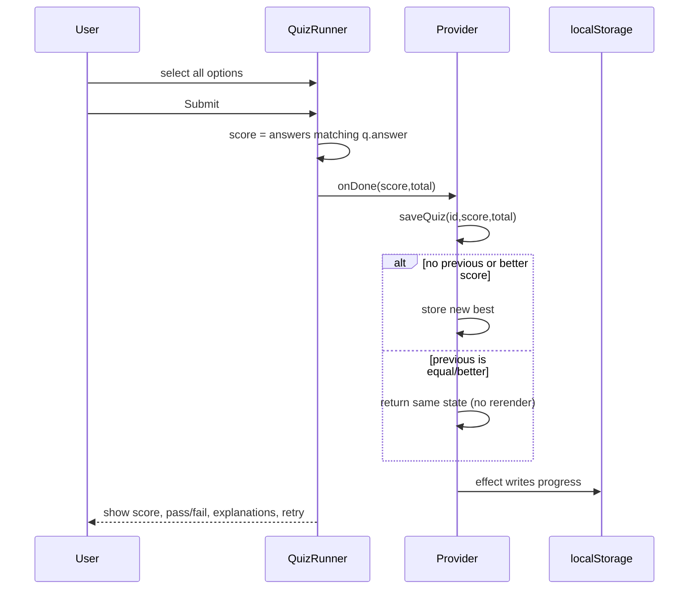

Relevant code: answers initialized as all `null` (`QuizRunner.tsx:16`); score computed from current answers (`19`); submit disabled until every question is answered (`81`); `saveQuiz` stores only a strictly better score (`store.tsx:73-78`); retry resets answers and submitted flag but keeps the same question order (`QuizRunner.tsx:27-30`); leaving the quiz tab unmounts `QuizRunner`, losing unsubmitted answers while the best saved score remains.

#### Exam submission

- Pool from quiz indices `[1,3]` across all sessions (`Pages.tsx:116`).
- Seeded shuffle: `seed = attempt * 7919`, then LCG `seed = (seed*9301+49297)%233280` (`Pages.tsx:117-120`).
- `attempt` is `Date.now() % 1000` at start (`128`); collisions are possible but harmless.
- `QuizRunner` receives `key={attempt}`, so a new attempt remounts cleanly (`131`).
- `saveExam` stores only the best overall score (`store.tsx:79-80`).
- Home displays the best exam score, colored green/amber by pass threshold (`Pages.tsx:72`).
- No exam history, timer, per-session breakdown, or certificate.

#### Language switch

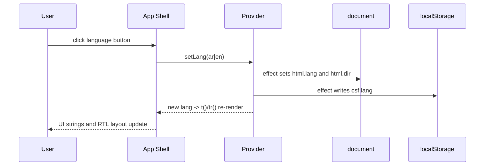

Arabic sets `dir="rtl"` and applies a Tahoma/Segoe UI/Arial font stack (`App.tsx:18`). The route is unchanged; session/tab URLs persist across language switches. Tool state is preserved because components remain mounted. `document.title` does not change with language or route.

### 6.7 Local component state details

| Component | State | Reset behavior |
|---|---|---|
| `Glossary` | `q` | Cleared on unmount/re-entry |
| `Exam` | `attempt` | Reset on unmount; start creates new seed |
| `QuizRunner` | `ans`, `done` | Retry clears; unmount clears |
| `CiaTool` | `pick[]` | Unmount only; no reset button |
| `PhishTool` | `sel[]`, `rev` | Reset button clears selection and reveal |
| `PermTool` | 9-bit `b[]` | Unmount only |
| `CidrTool` | `ip`, `pre` | Unmount only |
| `PortTool` | `q`, `f` | Unmount only |
| `FirewallTool` | `rules[]` | Unmount only |
| `MatchTool` | `pick[]`, `chk` | Changing a select clears check; no full reset |
| `OrderTool` | `picks[]`, `chk` | Reset button |
| `CipherTool` | `text`, `shift`, `dec`, `show` | Unmount only |
| `HashTool` | `a`, `b`, `exp` | Unmount only |
| `PasswordTool` | `pw` | Unmount only |
| `RbacTool` | 4×4 matrix, `chk` | Changing a cell clears check; no reset |
| `SqliTool` | `u`, `p` | Presets overwrite; no reset |
| `RiskTool` | 5 risks | Unmount only |
| `LogTool` | `log`, `run` | Restore sample button; Analyze toggles run |

Because tab bodies are conditionally mounted (`SessionView.tsx:99-160`), all of this state is lost when the learner switches tabs.

### 6.8 API integration — not implemented

Verified absence:

- No `fetch`, `axios`, `XMLHttpRequest`, WebSocket, `EventSource`, or `import.meta.env` in `src/`.
- No service/client/endpoint files, interceptors, auth token handling, server-state cache, loading spinner, retry, or server error UI.
- No API endpoints referenced anywhere.

The only external network activity is the learner clicking an external reference link; the app itself makes no requests.

**Implication:** sections of a typical frontend audit covering API error handling, token refresh, request cancellation, or backend contract validation are **not applicable**. No backend behavior should be inferred.

### 6.9 Authentication and authorization — not implemented

- No login, registration, logout, session, token, cookie, role, permission, or guard.
- All pages are public.
- No user identity is stored.
- Progress and exam scores are client-owned and can be edited in DevTools/localStorage.

If the course later issues certificates or instructor-visible grades, the current client-side progress model is **not trustworthy**. That requires server-side identity and authorization, not merely a frontend change.

### 6.10 State-related findings

| ID | Severity | Finding | Evidence |
|---|---|---|---|
| S1 | MEDIUM | Unguarded storage writes and initial read can throw | `store.tsx:44,47-54` |
| S2 | MEDIUM | Stored progress is not schema-validated or migrated | `store.tsx:33-41,88-96` |
| S3 | MEDIUM | Tab navigation discards unsubmitted quiz/tool state | `SessionView.tsx:99-160`; `QuizRunner.tsx:16-17` |
| S4 | MEDIUM | Monolithic context causes unrelated rerenders | `store.tsx:17-29,63-84` |
| S5 | LOW | No cross-tab synchronization | No `storage` listener |
| S6 | LOW | No per-session reset; only global reset | `store.tsx:81`; `Pages.tsx:79` |
| S7 | LOW | Completion data can exceed 100 if stored arrays outlive content | `store.tsx:89-90` |
| S8 | LOW | Quiz best score cannot be reset or reviewed per attempt | `store.tsx:73-78` |
| S9 | INFO | Quiz/exam progress is client-authoritative | localStorage only |
| S10 | INFO | No server state, API, or auth to audit | Verified absence of HTTP/auth code |

### 6.11 State recommendations

1. **Harden persistence:** wrap all storage access in a safe adapter; validate with a schema (Zod or hand-written guards); add a version field and migrations; fall back to `EMPTY`.
2. **Split contexts:** create `LanguageContext` and `ProgressContext`; expose selectors or separate hooks (`useLang`, `useProgress`) to limit rerenders.
3. **Validate progress:** clamp arrays to current content lengths, ignore unknown session ids, and guard division by zero.
4. **Preserve in-progress work:** lift quiz/tool state to a session-level store or persist it per session/tab; warn before discarding dirty quiz answers.
5. **Add cross-tab sync:** listen to `storage` events and reconcile (last-write-wins with timestamp, or merge best scores).
6. **Add per-session reset and progress export/import.**
7. **Make assessment trustworthy only with a backend:** if certificates are required, move scoring/identity server-side.
8. **Document the state model** in code comments or a short ADR, especially best-score semantics and completion weights.

## 7. Design system

**Verdict:** the project has a **consistent visual language**, but **not a formal design system**. There are no design tokens, no shared component library, and no styling documentation. Consistency is maintained by repeated Tailwind utility strings and a small set of conventions.

### 7.1 Foundations

#### Color palette

The app uses Tailwind’s default palette, always on a dark slate foundation.

| Role | Token | Hex | Usage |
|---|---|---|---|
| Page background | `slate-950` | `#020617` | App shell, table cells, deep surfaces |
| Surface | `slate-900` | `#0f172a` | Cards, panels, inputs |
| Elevated surface | `slate-800` | `#1e293b` | Badges, table heads, tracks |
| Border | `slate-800` / `slate-700` | `#1e293b` / `#334155` | Card and input borders |
| Primary text | `white` / `slate-100` | `#ffffff` / `#f1f5f9` | Headings, labels |
| Body text | `slate-300` | `#cbd5e1` | Paragraphs, descriptions |
| Muted text | `slate-400` | `#94a3b8` | Secondary metadata |
| Faint text | `slate-500` | `#64748b` | Metadata, glossary links, hints |
| Primary accent | `emerald-400` | `#34d399` | CTAs, active nav, progress, correct states |
| Primary accent hover | `emerald-300` | `#6ee7b7` | Hover, links |
| Secondary accent | `cyan-300/400` | `#67e8f9` / `#22d3ee` | Tool titles, glossary terms, info |
| Warning | `amber-300/400/500` | `#fcd34d` / `#fbbf24` / `#f59e0b` | Safety notices, not-passed, caution |
| Error | `red-400/500` | `#f87171` / `#ef4444` | Incorrect answers, dangerous permissions |
| Inverted text | `slate-950` | `#020617` | Text on emerald buttons/badges |

Diagram colors are a separate hardcoded array (`Diagram.tsx:4`): emerald `#34d399`, cyan `#22d3ee`, blue `#60a5fa`, violet `#a78bfa`, pink `#f472b6`, yellow `#fbbf24`, orange `#fb923c`, red `#f87171`.

**Assessment:** coherent and accessible for primary text, but faint text fails contrast (see §7.9).

#### Typography

| Aspect | Implementation |
|---|---|
| English font | Tailwind `font-sans` (system UI stack) |
| Arabic font | `font-[Tahoma,'Segoe_UI',Arial,sans-serif]` applied to the Shell (`App.tsx:18`) |
| Base size | Browser default 16 px |
| Headings | `text-xl`, `2xl`, `3xl`, `4xl`, `5xl` with `font-bold`/`extrabold`/`black` |
| Body | `text-sm`, `text-base`, `leading-relaxed` |
| Metadata | `text-xs`, `text-[11px]` |
| Eyebrow labels | `text-xs font-bold uppercase tracking-[0.3em]` |
| Arabic treatment | Global Tahoma stack; inline English terms use `dir="ltr"` but no `lang="en"` |

**Assessment:** clear hierarchy and generous heading weights; ad hoc arbitrary sizes (`text-[11px]`, `text-[14rem]`) and no type-scale tokens. The Arabic font choice is pragmatic but not loaded explicitly, so rendering varies by OS.

#### Spacing, radius, borders, elevation

- Spacing uses the Tailwind scale: `p-3/4/5/6/8/12`, `gap-1/1.5/2/3/4/5/8/10`, `space-y-2/3/4/5/6/8/10`; cards `p-3`–`p-6`; hero `p-8 md:p-12`; sections usually `space-y-5/6/8/10`. No spacing tokens or documented rhythm, but the scale is coherent enough.
- Radii: `rounded`, `rounded-lg` (buttons/inputs), `rounded-xl` (cards/alerts), `rounded-2xl` (major panels), `rounded-3xl` (hero), `rounded-full` (pills/bars).
- Borders: 1 px slate dominates; accent borders at 20–60% opacity.
- Elevation: essentially none. Flat, border-driven; no shadows. Translucent surfaces (`bg-slate-900/60`, `bg-slate-950/70`) over the page background.
- **Assessment:** consistent, modern dark “security dashboard” aesthetic; flat surfaces keep it readable and reduce noise.

#### Layout and breakpoints

| Breakpoint | Width | Observed behavior |
|---|---|---|
| Default | <640 px | Single-column stacks, wrapped nav, full-width cards |
| `sm` | ≥640 px | Brand text appears; some two-column grids |
| `md` | ≥768 px | Session grids 2 columns; hero larger; canvas rows |
| `lg` | ≥1024 px | Diagram grid 3 columns |

Global content width is `max-w-5xl` (64 rem) with `px-4` (`App.tsx:28`). Header is sticky, translucent, backdrop-blurred, and wraps at small widths. Home stats 2→4 columns; session list and glossary 1→2; flow diagrams horizontal on `md`; cycle SVG+list row on `md`; grid 2/3 columns.

**Assessment:** responsive intent is clear and mostly successful. Two lab tables and the session footer are exceptions (see §7.8).

### 7.2 Component patterns

#### Buttons

There is no `Button` component outside lab tools. Variants are repeated strings:

| Variant | Typical classes | Examples |
|---|---|---|
| Primary | `rounded-lg bg-emerald-500 px-4/5 py-2 font-semibold text-slate-950` | Mark read, submit, next session |
| Primary bright | `rounded-xl bg-emerald-400 px-6 py-3 font-bold text-slate-950` | Home CTAs, start exam |
| Secondary | `rounded-lg border border-slate-600 px-4 py-2 text-slate-200 hover:bg-slate-800` | Retry, exam CTA |
| Ghost/tab | `rounded-lg px-4 py-2 text-sm font-semibold` with active/inactive colors | Session tabs |
| Lab button | `Btn` with `active`/`disabled` | All tools |
| Danger/status | Toggle buttons colored red/emerald | Firewall ALLOW/DENY, RBAC cells |

**Issues:** no shared focus-visible style, no consistent size scale, no `aria-pressed` for toggle buttons, and active state is sometimes color-only.

#### Inputs

- Shared `inp` string: `rounded-lg border border-slate-700 bg-slate-900 px-3 py-1.5 text-sm text-slate-100 outline-none focus:border-cyan-400` (`LabToolsA.tsx:22`).
- Glossary search uses a larger variant with `focus:border-emerald-400` (`Pages.tsx:96`).
- Inputs generally lack `<label>`; `aria-label` exists only for IP, prefix, and password.
- `outline-none` removes the native focus ring; focus is indicated only by border color.
- Range sliders and checkboxes use `accent-emerald-400` / `accent-cyan-400`.
- No shared field wrapper, hint, error, or required indicator.

#### Cards, callouts, tables, navigation, modals, feedback

- Recurring card formula `rounded-2xl border border-slate-800 bg-slate-900/60 p-4/5` is repeated 15+ times; no `Card` component.
- Callouts have three semantic variants — `tip` (cyan, 💡), `warn` (amber, ⚠), `key` (emerald, 🔑) — plus lab safety (amber ⚠), expected outcome (emerald 🎯), and deliverable (cyan). No `Callout` abstraction.
- Lesson tables are wrapped in `overflow-x-auto`, header `bg-slate-800/70`, rows `border-t`, first column emphasized (`SessionView.tsx:46-53`). Port and RBAC tables are wrapped. **Firewall** and **log** tables are **not wrapped** and use `dir="ltr"` with English headers. No `<caption>`, no `scope="col"`, inconsistent header styling.
- Top nav: text links with rounded backgrounds; active session nav is emerald text on slate. Session tabs are pill-like anchors with emerald fill and completion checkmarks. No breadcrumbs; session position is “Session N / 20 · Phase”. No `aria-current`; no skip link.
- No modal, drawer, tooltip, popover, toast, or dialog. Global reset uses native `confirm()` (`Pages.tsx:79`). Inline feedback suits the linear course flow.
- Correct/incorrect text plus color in quizzes; tool-specific score lines; progress bars are plain divs with inline width; no global error/success banner.

### 7.3 CSS architecture

- **Single stylesheet:** `src/index.css` contains only `@import "tailwindcss";`.
- **No `tailwind.config.*`:** Tailwind v4 CSS-first configuration; no custom theme extension.
- **No CSS variables, `@theme`, `@layer`, or design-token file.**
- **No CSS modules, styled-components, Sass, or PostCSS config.**
- **No global base styles** beyond Tailwind preflight.
- All styling is utility-first and inline in JSX.
- Arbitrary values are used sparingly: `text-[11px]`, `text-[10px]`, `text-[14rem]`, `tracking-[0.3em]`, `font-[Tahoma,...]`, `max-h-56`.
- `cn` (`clsx` + `tailwind-merge`) exists but is never used, so there is no programmatic class merging.

**Consequence:** CSS is generated only from used classes, which is efficient, but visual changes require editing repeated strings and there is no single place to change a token, variant, or state style.

### 7.4 Design tokens

**None exist as a formal system.** De facto tokens are Tailwind’s default palette and scales, repeated literal class strings, the diagram `COLORS` array (`Diagram.tsx:4`), `PASS = 0.7` (assessment, not visual), and no CSS custom properties.

Recommended token layer:

```css
@theme {
  --color-surface: #0f172a;
  --color-surface-raised: #1e293b;
  --color-accent: #34d399;
  --color-accent-strong: #6ee7b7;
  --color-muted: #94a3b8;
  --radius-card: 1rem;
  --font-arabic: Tahoma, "Segoe UI", Arial, sans-serif;
}
```

Then map semantic components to those tokens. This preserves Tailwind ergonomics while making the system explicit.

### 7.5 RTL and bilingual design

**Strengths:** `dir` is set globally from the store (`store.tsx:48-49`); logical utilities are used consistently (`ms-*`, `me-*`, `ps-*`, `pe-*`, `border-s-*`, `text-start`, `start/end` positioning); tables use `text-start`; flow arrows flip with `md:rtl:rotate-180` (`Diagram.tsx:34`); the Arabic font stack applies to the whole shell; the glossary shows the English term with `dir="ltr"`.

**Weaknesses:** physical `space-x-1` in firewall controls (`LabToolsA.tsx:285`); prev/next and mobile diagram arrows are not RTL-aware; technical tables use `dir="ltr"` with English headers, but surrounding labels are English-only; inline English lacks `lang="en"`; some UI copy, aria labels, placeholders, and the document title remain English-only; `~22h` uses a Latin `h` in Arabic mode; Arabic strings are longer, and some buttons/footers lack wrapping.

**Assessment:** stronger RTL implementation than many first-pass bilingual apps, but incomplete at the chrome and accessibility layers.

### 7.6 Motion and animation

- Transitions: `transition` on cards/buttons; `transition-all` on progress bars; `hover:` color/background changes.
- No keyframes, page transitions, scroll animations, parallax, GSAP, Framer Motion, or Lottie.
- No `prefers-reduced-motion` handling.
- The only continuously animated element is a progress-width transition.

**Assessment:** appropriately restrained for an instructional app. Add reduced-motion guards if more animation is introduced.

### 7.7 Design consistency matrix

| Element | Consistency | Evidence |
|---|---|---|
| Page background/text | High | Slate-950 + slate-200 shell |
| Card surfaces | High | Repeated `rounded-2xl border-slate-800 bg-slate-900/60` |
| Primary actions | High | Emerald fill + slate-950 text |
| Secondary actions | Medium | Border variants differ between pages/tools |
| Inputs | Medium | Two input class patterns; labels inconsistent |
| Tables | Low–Medium | Different wrappers, headers, `dir` usage |
| Callouts | Medium | Repeated but not componentized |
| Progress bars | Medium | Four implementations with different heights |
| Navigation | High | Consistent nav/tab visual language |
| RTL | Medium–High | Logical utilities mostly, some physical exceptions |
| Accessibility states | Low | Color-only selection, missing ARIA state |
| Typography | Medium | Clear hierarchy, arbitrary sizes |
| Motion | High | Minimal and consistent |

### 7.8 Responsive detail

**Working:** header wraps; hero text scales 4xl→5xl; stats 2→4; session list and glossary 1→2; diagram grid 1→2→3; most forms use `flex-wrap`; lesson/port/RBAC tables scroll.

**Problematic:**

| Location | Issue |
|---|---|
| `LabToolsA.tsx:272-289` firewall table | 5 columns + buttons, no `overflow-x-auto`; can exceed 320 px |
| `LabToolsB.tsx:267-280` log table | 5 columns, no wrapper; can overflow |
| `SessionView.tsx:162-165` footer | `justify-between` without `flex-wrap`; long Arabic labels can overflow |
| `text-[11px]` metadata | Small for mobile readability |
| Sticky header | Can consume significant vertical space when nav wraps |
| Touch targets | `py-1.5` buttons ≈32 px high; below 44 px recommendation |
| `space-x-1` firewall controls | Physical spacing, not RTL-aware |

There is no mobile-specific navigation pattern; the full nav wraps, which is usable but dense.

### 7.9 Color contrast

| Foreground | Background | Ratio | AA normal text (4.5:1) |
|---|---|---:|---|
| `slate-500` `#64748b` | `slate-950` `#020617` | **4.24:1** | ❌ fails |
| `slate-500` `#64748b` | `slate-900` `#0f172a` | **3.75:1** | ❌ fails |
| `slate-400` `#94a3b8` | `slate-900` `#0f172a` | 6.96:1 | ✅ passes |
| `slate-400` `#94a3b8` | `slate-950` `#020617` | 7.87:1 | ✅ passes |
| `slate-300` `#cbd5e1` | `slate-950` `#020617` | 13.59:1 | ✅ passes |
| `emerald-300` `#6ee7b7` | `slate-950` `#020617` | 13.23:1 | ✅ passes |
| `emerald-400` `#34d399` | `slate-950` `#020617` | 10.49:1 | ✅ passes |
| `amber-400` `#fbbf24` | `slate-950` `#020617` | 12.08:1 | ✅ passes |
| `red-400` `#f87171` | `slate-950` `#020617` | 7.29:1 | ✅ passes |

`text-slate-500` is used for 11 px metadata (`Pages.tsx:26-28`), glossary session links (`102`), and faint labels. This is a concrete WCAG AA failure for normal-size text.

### 7.10 Design-system findings

| ID | Severity | Finding | Evidence |
|---|---|---|---|
| D1 | MEDIUM | No design tokens or shared component library | `index.css:1`; no `tailwind.config`; repeated classes |
| D2 | MEDIUM | Faint text fails contrast | `Pages.tsx:26-28,95,102`; 3.75–4.24:1 |
| D3 | MEDIUM | Two lab tables and footer not responsive | `LabToolsA.tsx:272`; `LabToolsB.tsx:267`; `SessionView.tsx:162` |
| D4 | MEDIUM | Incomplete UI localization breaks bilingual design | `Pages.tsx:54,62`; `LabToolsA.tsx:273`; `LabToolsB.tsx:165,268` |
| D5 | LOW | Repeated button/card/callout/progress patterns | 15+ card strings; 4 progress bars |
| D6 | LOW | Inconsistent table wrappers/headers | Lesson/Port/RBAC wrapped; Firewall/Log not |
| D7 | LOW | No focus-visible styling; inputs remove outline | `LabToolsA.tsx:22`; `Pages.tsx:96` |
| D8 | LOW | Physical spacing in RTL | `LabToolsA.tsx:285` |
| D9 | LOW | Arbitrary type sizes and no type scale tokens | `text-[11px]`, `text-[14rem]` |
| D10 | INFO | No shadows/modals/toasts; flat, inline-feedback design | Consistent and appropriate |

### 7.11 Design recommendations

**Immediate**

1. Replace `text-slate-500` small text with `slate-400` or increase size/weight.
2. Add `overflow-x-auto` wrappers to firewall/log tables; add `flex-wrap` to the session footer.
3. Localize remaining UI chrome, aria labels, table headers, placeholders, and document title.
4. Add `focus-visible` styles to buttons, links, tabs, and inputs; do not rely on border color alone.
5. Mark inline English with `lang="en"` in Arabic mode.

**Short-term**

6. Introduce semantic tokens via Tailwind v4 `@theme`.
7. Create `Button`, `Card`, `Input/Field`, `Badge`, `Callout`, `ProgressBar`, `DataTable`, and `LabShell` components.
8. Replace physical `space-x` with logical `gap`/`ms-*`.
9. Add `aria-pressed`/radio semantics and distinguish active states beyond color.
10. Add reduced-motion guards for any future animation.

**Medium-term**

11. Document the design system with usage rules, variants, and accessibility requirements.
12. Add visual regression tests (Playwright screenshots) for EN/AR at mobile/tablet/desktop widths.
13. Consider a light theme only if a real requirement exists; the dark theme is coherent and should not be diluted casually.

## 8. Code quality

### 8.1 Metrics

| Metric | Value |
|---|---:|
| Source files in `src/` | 26 |
| Test files | 2 |
| Source lines (`src/` + `tests/`) | ~3,050 |
| Largest code module | `LabToolsA.tsx` — 372 lines |
| Second largest | `LabToolsB.tsx` — 284 lines |
| Largest content module | `s17_18.ts` — 269 lines |
| React components | 33 |
| `any` usages in `src/` | 0 |
| `@ts-ignore` / `@ts-expect-error` | 0 |
| `dangerouslySetInnerHTML` / `innerHTML` | 0 |
| Non-null assertions (`!`) | 2 (`SessionView.tsx:71`, `main.tsx:6`) |
| Double casts | 3 (`store.tsx:30`, `store.tsx:36` implicit parse, `router.ts:21`) |
| Runtime dependencies | 4, of which 2 unused |
| Test count | 154 |
| Type check | Pass |
| Lint/format config | None |

> Line counts vary with blank-line/comment counting; figures come from a pass over tracked source files.

### 8.2 TypeScript configuration and usage

`tsconfig.json` enables `strict`, `noUnusedLocals`, `noUnusedParameters`, `noFallthroughCasesInSwitch`, `noEmit`, `jsx: react-jsx`, `moduleResolution: bundler`, `allowImportingTsExtensions`, and `baseUrl`/`paths["@/*"]` (`tsconfig.json:1-31`).

**Strengths:** strict mode is enabled, not merely declared; unused locals/parameters are errors; discriminated unions (`Route`, `ToolId`) are used effectively; content is fully typed; `npx tsc --noEmit` passes.

**Gaps:** `include` covers only `["src", "vite.config.ts"]` (`tsconfig.json:30`), so **tests are not type-checked**; Vitest transpiles them without type checking. Tests use `(globalThis as any)` (`render.test.tsx:11`) and reference `React.ReactElement` without an explicit import. The `@/*` alias is configured in both `tsconfig` and `vite.config.ts` but never used. `types: ["node"]` narrows ambient types; DOM libs are still explicit.

### 8.3 Type-safety escape hatches

| Location | Code | Risk |
|---|---|---|
| `store.tsx:30` | `createContext<Ctx>(null as unknown as Ctx)` | A consumer outside Provider compiles but crashes at runtime |
| `store.tsx:36` | `return { ...EMPTY, ...JSON.parse(raw) }` | `JSON.parse` returns `any`; no schema validation |
| `router.ts:21` | `TABS.includes(parts[2] as Tab)` | Cast after membership check is acceptable but could be a type guard |
| `SessionView.tsx:71` | `PHASES.find(...)!` | Non-null assertion can crash if content phase is invalid |
| `main.tsx:6` | `getElementById("root")!` | Standard Vite pattern; safe if `index.html` is correct |
| `tests/render.test.tsx:11` | `(globalThis as any).localStorage` | Tests only; not type-checked anyway |

No `any` exists in production source — a meaningful strength. Remaining issues are localized casts, not systemic looseness.

**Type-design strengths:** `L = {en, ar}` prevents partial translations at the type level; `ToolId` drives exhaustive dispatch; `Route` makes invalid page/tab combinations unrepresentable in code (though the parser can still produce fractional ids); `Session`, `Section`, `QuizQ`, etc. are explicit and reusable; props interfaces are inline but complete.

**Type-design weaknesses:** numeric session ids are `number`, not a constrained/branded type; `Progress` uses `Record<number, ...>` without runtime validation, and JSON turns keys into strings; `Ref.title`/`org` are English-only while the rest of content is `L`, an undocumented asymmetry; `PHASES` ids are `1|2|3|4|5` and `Session.phase` is constrained, so the `find` assertion is unnecessary defense loss; `MATCH`/`ORDER` tool data is optional on `Lab`, so the type allows a `match` tool without `match` data — only tests catch it.

### 8.4 Naming and readability

**Strengths:** components PascalCase, hooks `use*`, helpers camelCase; file names match primary exports; content modules named by session ranges (`s01_02.ts`); section comments in `LabToolsA/B` aid navigation; bilingual helper `l(en, ar)` is concise and consistent.

**Weaknesses:** heavy abbreviations (`s`, `st`, `p`, `q`, `hw`, `lab`, `tr`, `t`, `d`, `n`, `b`, `m`, `r`, `tx`, `pk`, `chk`, `rev`, `sel`, `pick`, `picks`, `ha`, `hb`, `exp`); single-letter variables in complex calculations (`CidrTool`, `RiskTool`, `HashTool`, `PermTool`) reduce readability; `S` for strings and `L` for the bilingual type are terse; extremely long JSX lines (`SessionView.tsx:94,118`, `Pages.tsx:62`, `LabToolsA.tsx:115,356`) are hard to review and diff; nested ternaries (`QuizRunner.tsx:51-59`, `SessionView.tsx:61`) obscure state logic; data names (`b`, `m`, `r`, `pk`, `tx`) are domain-specific but undocumented.

**Recommendation:** keep terse names only in tiny scopes; extract long JSX into small subcomponents/helpers; replace nested ternaries with variant maps or `cn`.

### 8.5 Complexity

| File | Lines | Assessment |
|---|---:|---|
| `LabToolsA.tsx` | 372 | **High**: 8 tools + 3 primitives in one module |
| `LabToolsB.tsx` | 284 | **High**: 7 tools in one module |
| `Pages.tsx` | 136 | Medium: 4 unrelated pages |
| `SessionView.tsx` | 169 | Medium: 5 tab bodies inline |
| `Diagram.tsx` | 148 | Medium-low: 4 small renderers |
| `QuizRunner.tsx` | 100 | Low: focused |
| `App.tsx` | 49 | Low |

Most tool functions are 25–60 lines with a single visible purpose. The most complex are `FirewallTool` (rule evaluation, reordering, packet checks, success state), `CidrTool` (parsing, bit math, classification, conditional error/result), `RbacTool` (4×4 matrix state, target comparison, cycling), `RiskTool` (derived sorting, thresholds, updates), `LogTool` (regex parsing, aggregation, classification), and `OrderTool` (deterministic shuffle, ordered picks, correctness coloring). They combine **data definitions, domain calculations, and JSX** in one function, making isolated unit testing harder.

**Cyclomatic hot spots:** nested host classification in `CidrTool` (`LabToolsA.tsx:162`); nested ternary class selection in `QuizRunner` (`51-59`); multi-branch result rendering in `LogTool` (`274`); `PermTool`’s warning expression (`115`) combines three conditions with domain semantics — the “everyone can read” branch omits group-read `b[3]`, so `chmod 604` is mislabeled.

**Recommendation:** extract pure functions (`evaluateFirewall`, `parseCidr`, `rateRisk`, `parseAuthLog`, `shuffleDeterministic`, `permissions`) into `lib/` and unit test them.

### 8.6 Duplication

**UI duplication:** card surfaces, primary/secondary buttons, progress bars, badges, and callouts are repeated as string literals; `Box`/`Btn`/`inp` exist only for labs and pages do not use them; four progress-bar implementations with different heights/wrappers; five result/score display patterns.

**Logic duplication:** correct/incorrect comparison and message rendering in `CiaTool`, `MatchTool`, `OrderTool`, and `QuizRunner`. Good centralization exists in `toggleArr` (lab/homework), `status()` (completion), `QuizRunner` (quiz/exam), and `sha256`/`caesar`/`passwordStats` (pure helpers).

**Data duplication:** tool data in components (CIA items, phish parts, ports, firewall rules, RBAC matrix, risk register, log sample); bilingual strings split between `strings.ts`, content `L`, and inline `tr(en, ar)`; hardcoded constants `20`, `40`, `70%`, `0.7`, `25`, and `[1,3]`.

**Content duplication:** 150 glossary terms with 148 unique English terms; “Vulnerability” and “Compliance” appear twice. References may repeat across sessions (not verified for all 85 URLs).

**Recommendation:** extract a UI kit and pure domain helpers; move tool data into typed content; centralize constants.

### 8.7 SOLID principles

**Single Responsibility — partially violated.** Content, store, router, and helper modules are focused. `LabToolsA/B` combine primitives, data, domain logic, and JSX; `Pages.tsx` holds four unrelated pages; `SessionView.tsx` holds layout, section renderer, checkbox, and tool dispatcher; the store combines language, progress, persistence, and derived status.

**Open/Closed — extensible with friction.** Adding a tool requires editing `ToolId`, the `SessionView` switch, a component, and content. Adding a page requires the `Route` union, parser, `href`, and `Shell` switch. Adding a session requires content, `content/index.ts`, tests, and the hardcoded `20`.

**Liskov Substitution — not materially applicable.** No inheritance hierarchies; component contracts are simple and consistent.

**Interface Segregation — violated by the store context.** A component needing only translation receives the entire progress API, and vice versa; `Shell` needs only language but rerenders on progress; `SectionView` needs only `t` but consumes the full context.

**Dependency Inversion — not applied.** Components import concrete content/store modules; persistence is a concrete `localStorage` call inside the provider, not an injectable repository. Acceptable for a static app, but it reduces testability and portability.

**Overall:** pragmatic, not dogmatic. The code is coherent for its size, but the context and god modules are the clearest SOLID violations.

### 8.8 Patterns and error handling

**Present:** Provider/Context; custom hook; data-driven rendering; discriminated unions + exhaustive switch; strategy-like tool selection; derived state; memoization (`useMemo` in 6 places); best-score retention; pure helper module; single-file static build.

**Absent:** error boundary; repository/service abstraction; reducer/state machine; component variants/design-system primitives; schema validation; lazy loading/Suspense; route metadata; feature flags/configuration.

**Error handling present:** `load()` catches storage read/JSON parse errors and falls back to `EMPTY` (`store.tsx:33-41`); `CidrTool` validates IPv4 and shows an inline error (`LabToolsA.tsx:142-153`); `QuizRunner` disables submit until all questions are answered (`81`); `MatchTool`/`OrderTool` disable check until complete (`328,365`); the router normalizes invalid routes instead of throwing (`13-26`); lab tools guard optional match/order data (`SessionView.tsx:27-28`).

**Error handling absent:** no React error boundary (any render error blanks the app); no storage write guards; no progress schema validation; no 404; no error reporting/logging; no user-facing message for corrupted progress; no handling for `PHASES.find` failure; no fallback if an externally sourced tool id is unknown (TypeScript catches compile-time cases); no network errors because no network calls exist.

### 8.9 Dead code, unused assets, and drift

| Item | Evidence | Impact |
|---|---|---|
| `src/utils/cn.ts` unused | No imports; `clsx`/`tailwind-merge` only there | Dead file; two unused dependencies |
| Unused strings `S.diagram`, `tool`, `tasks`, `status`, `checkAnswers`, `view`, `ofLabel`, `all` | No references in `src` | Minor dead copy |
| Unused `@` alias | `tsconfig.json:19-22`; `vite.config.ts:14-17` | Misleading configuration |
| README says 6–7 quiz questions | S7 has 8 (`s07_08.ts:84-93`) | Documentation drift |
| README says references are link-checked | Tests only check `https://` (`content.test.ts:83`) | Overstated claim |
| README says “fully bilingual” | UI chrome has English-only strings | Overstated claim |
| `package.json` name `react-vite-tailwind` | Generic scaffold name | Poor project identity |
| No `test` script | README instructs `npx vitest run` | DX friction |
| No `typecheck` script | README instructs `npx tsc --noEmit` | DX friction |

### 8.10 Coupling, cohesion, and testability

**Good cohesion:** `lib/sha256.ts` (one domain), `content/*` (data only), `router.ts` (routing only), `QuizRunner` (assessment only), `Diagram` (visualization only).

**Poor cohesion:** `LabToolsA/B` (7–8 unrelated tools plus primitives), `Pages.tsx` (four unrelated pages), `store.tsx` (state + persistence + derivation), `SessionView.tsx` (layout + section rendering + checkbox + tool dispatch).

**Coupling:** components directly import `SESSIONS` and `status`, making them hard to test in isolation; `LabToolsB` depends on `LabToolsA` for primitives; `strings.ts` depends on content types for `l`; the hardcoded session count couples router, header, tests, and Home; `ToolId` couples content to UI component names.

**Testability — good:** pure helpers are trivially testable and tested; `parse()` is pure and tested; `QuizRunner` has a clean `questions`/`onDone` contract; content is data and easy to validate.

**Testability — difficult:** tool logic is embedded in components with local state; components depend on global context and the full `SESSIONS` array; `useRoute` uses global `location`; `Provider` reads localStorage at initialization; no storage dependency injection; tests are excluded from `tsc`.

**Recommendation:** extract pure calculations, add a storage adapter, and introduce a `renderWithProvider` test helper.

### 8.11 Code-quality findings

| ID | Severity | Finding | Evidence | Recommendation |
|---|---|---|---|---|
| Q1 | MEDIUM | Two god modules mix tools, data, and primitives | `LabToolsA.tsx`; `LabToolsB.tsx` | Split per tool; move primitives |
| Q2 | MEDIUM | Content data embedded in components | `LabToolsA.tsx:29-36,70-78,248-262`; `LabToolsB.tsx:117-124,194-200` | Typed tool-content modules |
| Q3 | MEDIUM | Tests excluded from `tsc` | `tsconfig.json:30` | Add `tsconfig.test.json` |
| Q4 | MEDIUM | No lint/format/CI/scripts | `package.json:6-10` | ESLint, Prettier, CI, scripts |
| Q5 | MEDIUM | Hardcoded counts/constants across modules | `router.ts:20`; `SessionView.tsx:81`; `Pages.tsx:116`; `store.tsx:15` | Central constants |
| Q6 | LOW | Dead `cn` utility and unused dependencies | `utils/cn.ts`; `package.json:12,15` | Remove or adopt |
| Q7 | LOW | Unused `S` keys | `strings.ts` | Remove |
| Q8 | LOW | Long lines and nested ternaries | `SessionView.tsx:94,118`; `QuizRunner.tsx:51-59` | Extract helpers/components |
| Q9 | LOW | Non-null assertions and double casts | `SessionView.tsx:71`; `store.tsx:30`; `router.ts:21` | Guards/type predicates |
| Q10 | LOW | Definition list order reversed on Home | `Pages.tsx:63` | `<dt>` before `<dd>` |
| Q11 | LOW | Documentation drift | `README.md:21,24` | Update or automate claims |
| Q12 | INFO | No `any` in production source | Verified grep | Maintain |

### 8.12 Code-quality recommendations

**Immediate**

1. Add `test`, `typecheck`, `lint`, and `format` scripts.
2. Add ESLint + Prettier and a CI workflow running `tsc`, tests, lint, and build.
3. Add a `tsconfig.test.json` or include `tests` in the main config.
4. Remove `utils/cn.ts` and unused dependencies, or adopt `cn` in components.
5. Remove unused `S` keys.

**Short-term**

6. Extract pure functions from lab tools and unit test them.
7. Split `LabToolsA/B` into `components/tools/<Tool>.tsx` and `components/ui/` primitives.
8. Split `Pages.tsx` into `pages/` modules.
9. Split the store into language/progress contexts and a storage adapter.
10. Centralize constants (`TOTAL_SESSIONS`, `PASS`, `EXAM_QUESTIONS`, completion weights).

**Medium-term**

11. Introduce a typed tool-content model instead of embedded arrays.
12. Add a reducer or state machine for quiz/exam to make transitions explicit and testable.
13. Add an error boundary and 404 route.
14. Document non-obvious domain logic (chmod bits, CIDR edge cases, exam seeding).
15. Track complexity and enforce file-size/function-size guidelines in review.

## 9. Security

**Scope:** frontend security posture of `src/`, build configuration, and runtime dependencies.  
**Method:** static source review, dependency audit, data-flow tracing, and configuration inspection.

### 9.1 Executive summary

The application has a **very small attack surface**. It is a client-only static course with:

- **No backend, API, database, authentication, or authorization.**
- **No secrets, tokens, cookies, or environment variables.**
- **No `dangerouslySetInnerHTML`, `innerHTML`, `eval`, or `new Function`.**
- **No third-party scripts, analytics, ads, or remote fonts.**
- **No runtime network requests.**

The primary security concerns are therefore **not** remote compromise but:

1. **Dev-tooling dependency advisories** (Vite/esbuild on Windows).
2. **Client-side integrity** — progress and exam scores are editable in localStorage.
3. **Missing defense-in-depth headers** if served over HTTP (CSP, referrer policy).
4. **A minor correctness issue in a security education tool** (the chmod “everyone can read” condition) that can mildly mislead learners.

**No CRITICAL or exploitable remote-code-execution/XSS finding was identified in the frontend.**

### 9.2 Threat model and trust boundaries

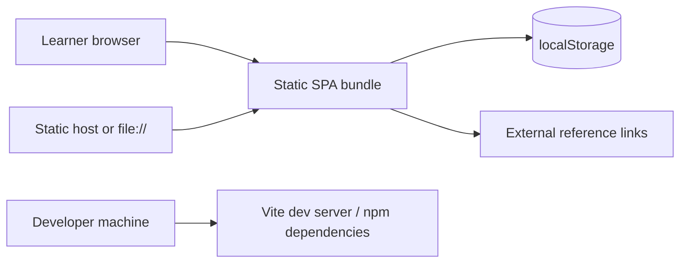

| Asset | Sensitivity | Protection |
|---|---|---|
| Course content | Public educational material | Static bundle; no confidentiality need |
| Language preference | Low | localStorage |
| Learning progress / scores | Low–medium (integrity matters for assessment) | localStorage only; user-editable |
| User identity | None collected | No accounts |
| Secrets/API keys | None present | No env/config secrets |
| Developer machine | Medium–high | Dev server and dependencies |

**Trust boundaries:**

- The browser is fully trusted to execute the bundle; there is no server trust boundary.
- localStorage is **untrusted input** on load and should be validated (it currently is not).
- External links leave the app; they are not fetched by the app.
- The dev server is a separate, elevated-risk surface.

### 9.3 XSS and unsafe rendering

A source-wide search found **no** `dangerouslySetInnerHTML`, `innerHTML`, `outerHTML`, `document.write`, `eval`, `new Function`, string-argument timers, `javascript:` URLs, or user-controlled `href`/`src` attributes.

| Input | Rendering | Safe? |
|---|---|---|
| Glossary search | React text interpolation | Yes |
| CIDR IP/prefix | React text interpolation + numeric formatting | Yes |
| Caesar text and brute-force output | React text interpolation | Yes |
| Hash inputs and expected hash | React text interpolation | Yes |
| Password input | React text interpolation | Yes |
| SQLi username/password | Interpolated into `<pre>` as JSX text, plus `JSON.stringify` | Yes — escaped, not executed |
| Firewall toggles | Numeric/string state | Yes |
| Log textarea | Parsed with regex; rendered as table cells | Yes |
| Match/order selections | Indexes and localized strings | Yes |

**`SqliTool` specifically:** the “vulnerable” SQL string is built with template literals and rendered inside `<pre>{...}</pre>` (`LabToolsB.tsx:176`). React escapes it. No SQL executes; there is no database. This is a display-only simulation and is correctly described as such in the UI.

**`LogTool`:** input is split and matched with a fixed regex (`LabToolsB.tsx:251-259`); results are rendered as text. No injection path and no ReDoS-sensitive nested quantifiers.

### 9.4 External links

Reference URLs are rendered as:

```tsx
<a href={r.url} target="_blank" rel="noopener noreferrer">
```

Evidence: `SessionView.tsx:155`.

`noopener` prevents `window.opener` manipulation; `noreferrer` suppresses the Referer header. Content tests require `https://` for every reference (`tests/content.test.ts:83`). However, URLs come from static content and are not validated against a host allowlist. A compromised content file could add an arbitrary https URL. This is a content-supply-chain concern, not a runtime XSS.

**Recommendation:** if content becomes externally sourced, validate URLs with `new URL`, require `https:`, and consider an allowlist or link-checking pipeline.

### 9.5 Input handling and validation

| Input | Validation | Notes |
|---|---|---|
| Session id | Range check `1..20` | No integer check; fractional ids reach a dead branch |
| Tab | Membership whitelist | Invalid values silently become lesson |
| CIDR IPv4 | 4 octets, digits, ≤255 | Rejects malformed input; accepts leading zeros |
| CIDR prefix | Clamped 0–32 | Decimal values are not rounded; shift truncates |
| Quiz answers | Index equality | No bounds check against options length; content tests enforce 4 options |
| Match selections | `-1` sentinel + option indexes | Check disabled until all selected |
| Order selections | Index list | Check disabled until all n chosen |
| Numeric ranges | HTML `min`/`max` + `Number()` | State can still be set out-of-range via DevTools; rendering handles it |
| Hash expected value | Trim/lowercase compare | No length validation before compare |
| SQLi input | Regex heuristics for display message | No execution; safe |
| Log input | Regex per line | Linear; no ReDoS-sensitive nesting |
| Storage progress | **No validation** | Main input-validation gap |

**Assessment:** validation is adequate for local educational tools, except localStorage, which is unvalidated and can crash the app.

### 9.6 Storage and client-side integrity

| Key | Data | Sensitivity |
|---|---|---|
| `csf.lang` | `"en"` or `"ar"` | None |
| `csf.progress.v1` | Read flags, tick-offs, best quiz/exam scores | Low; integrity-relevant for assessment |

No tokens, credentials, personal data, or secrets are stored.

**Risks:**

- **Tampering:** a learner can edit localStorage or call `setProgress` via DevTools to mark everything complete or forge a perfect exam score. There is no server verification.
- **Corruption:** malformed JSON is caught, but valid JSON with wrong shapes is not; `status()` can throw.
- **Availability:** blocked/quota-full storage can throw during initialization or writes.
- **Cross-tab races:** last write wins; no `storage` event reconciliation.

**Assessment:** acceptable for a self-study course. **Not acceptable** as a basis for certificates, grades, or compliance records without server-side identity and scoring.

**Recommendations:** wrap storage in a safe adapter with try/catch; validate progress with a schema and version/migrate it; treat progress as a cache, not an authority; move scoring/completion verification server-side if credentials are added.

### 9.7 Authentication, authorization, and secrets

**Authentication/authorization: not implemented.** Verified absence of login/registration/logout, session or token handling, cookies, auth context/guard, role/permission checks, protected routes, and password handling. There is no client-side authorization logic to bypass because there are no protected resources. The only “access control” is the public route set.

**Important:** the absence of auth is a **design characteristic**, not a vulnerability in itself. It becomes a problem only if the application later claims trusted completion or restricted content. Do not treat frontend checks as a substitute for backend authorization.

**Secrets:** no `.env`/`.env.*` or config secrets; no `import.meta.env`; no API keys, tokens, or credentials in source or build config; no third-party scripts or CDN references that could leak data. The only hardcoded URLs are public reference links in content. **No secret-exposure finding.**

### 9.8 Dependency security

**Runtime dependencies**

| Package | Version | Used? | Notes |
|---|---|---|---|
| `react` | 19.2.6 | Yes | Core UI |
| `react-dom` | 19.2.6 | Yes | DOM renderer |
| `clsx` | 2.1.1 | **No** | Only referenced by unused `cn.ts` |
| `tailwind-merge` | 3.4.0 | **No** | Only referenced by unused `cn.ts` |

`npm audit --omit=dev` → **0 vulnerabilities**.

**Dev tooling** — `npm audit` → **2 vulnerabilities (1 low, 1 high)**:

- **Vite 7.0.0–7.3.6 (high)** — multiple advisories including Windows UNC/NTLM hash disclosure and launch-editor argument handling. Fix is Vite 7.3.8, outside the exact `7.3.2` pin, requiring an explicit upgrade.
- **esbuild 0.27.3–0.28.0 (low)** — arbitrary file read when running the dev server on Windows.

**Context:** these affect the **development server and developer machine**, not the production static bundle. The audit host is Windows, so the Windows-specific advisories are relevant to local development.

**Recommendation:** upgrade Vite to ≥7.3.8 and the resolved esbuild version, refresh `package-lock.json`, re-run `npm audit`, and add automated dependency scanning/renovation to CI.

**Supply-chain surface:** only four runtime dependencies, two unused; no UI kit, router, state, HTTP, or animation dependency; no postinstall scripts in the project’s own configuration; no lockfile integrity check beyond npm defaults; no SBOM or provenance process. Small and favorable, with one concrete dev-tooling advisory.

### 9.9 Transport, headers, and CSP

The app has no runtime network calls, so transport security mostly concerns how the built file is served.

**Current state:** `index.html` has no CSP, `Referrer-Policy`, `X-Content-Type-Options`, `Permissions-Policy`, or `X-Frame-Options`. If served over HTTPS by a competent host, transport confidentiality is fine. If opened via `file://`, there is no origin/transport boundary; the single-file build is intentionally designed for this. Inlining JS/CSS makes a strict CSP harder (needs hashes or nonces).

**Risks:** no CSP defense-in-depth against an injected script if a future change introduces an XSS sink; no clickjacking protection if framed; no referrer policy for external links (though `noreferrer` is set on those links); no MIME-sniffing protection header at the app level.

**Recommendation:** if served on the web, set headers at the host/CDN:

```
Content-Security-Policy: default-src 'self'; script-src 'self' 'sha256-...'; style-src 'self' 'unsafe-inline'; img-src 'self' data:; connect-src 'none'; frame-ancestors 'none'; base-uri 'none'; form-action 'none'
Referrer-Policy: no-referrer
X-Content-Type-Options: nosniff
Permissions-Policy: camera=(), microphone=(), geolocation=()
```

For the single-file build, either compute script hashes at build time or produce a web-target build with external JS for a stricter CSP.

### 9.10 Privacy

**Strengths:** no analytics, telemetry, cookies, fingerprinting, ads, or third-party requests; no remote fonts or images; no personal data collection; only local learning progress and language preference stored; external links use `rel="noreferrer"`.

**Considerations:** progress is stored indefinitely in localStorage until reset; on shared devices another user can see completion/scores. Not sensitive, but worth documenting. No privacy policy is required by the current implementation because no data leaves the device.

### 9.11 Security education content and lab safety

**Strengths:** labs are local and simulated — no scanning, attacking, or data exfiltration; each lab includes a safety/ethics note (e.g., `s07_08.ts:74`); SQL injection is display-only and explicitly labeled as a simulation; log samples use RFC 5737 documentation ranges (`203.0.113.0/24`, `198.51.100.0/24`, `192.0.2.0/24`); phishing examples use look-alike/example domains; the password tool explains that entropy estimates assume random characters; custom SHA-256 is educational only, not used to protect secrets.

**Correctness concern:** the chmod warning logic is mostly correct. Bits are laid out row-major as `[owner r,w,x, group r,w,x, others r,w,x]` (`LabToolsA.tsx:110,113,125-126`), so `b[7]` is others-write and the world-writable check is **correct**. The “Everyone can read it” branch tests `b[6] && b[0]` and omits group-read `b[3]` (`115`), so `chmod 604` is mislabeled as readable by everyone. Tracked as **L1** (LOW); the fix is one condition — `b[0] && b[3] && b[6]` — plus tests.

### 9.12 Security findings

| ID | Severity | Finding | Evidence | Recommendation |
|---|---|---|---|---|
| SEC1 | **HIGH** | Vite dev-server advisories (Windows-relevant) | `package.json:25`; `npm audit` | Upgrade Vite ≥7.3.8, refresh lockfile, add scanning |
| SEC2 | LOW | “Everyone can read” warning omits group-read | `LabToolsA.tsx:115` tests `b[6] && b[0]`; correct is `b[0] && b[3] && b[6]` | Fix condition; unit-test 604/640/444/777. World-writable `b[7]` is correct. |
| SEC3 | MEDIUM | localStorage unguarded and unvalidated | `store.tsx:33-54,88-96` | Safe adapter + schema + migration |
| SEC4 | MEDIUM | Client-side progress/scores are forgeable | `store.tsx`; localStorage | Treat as cache; server-side verification if credentials |
| SEC5 | LOW | No CSP/security headers | `index.html` | Add headers at host; consider external-JS build |
| SEC6 | LOW | External URLs not host-allowlisted | `SessionView.tsx:155`; static content | Validate/allowlist if content becomes external |
| SEC7 | LOW | No 404/error boundary can expose stack traces in dev | `App.tsx`; `router.ts` | Add boundary; ensure production error UI |
| SEC8 | INFO | Two unused runtime dependencies increase surface | `package.json:12,15`; `utils/cn.ts` | Remove or use |
| SEC9 | INFO | No auth/API/secret exposure | Verified absence | Maintain clear scope |
| SEC10 | INFO | Strong privacy posture | No network requests | Preserve |

### 9.13 Security strengths

1. **No unsafe HTML rendering.** React’s escaping is relied upon consistently.
2. **No secrets or environment exposure.**
3. **No network attack surface.** No API, cookies, tokens, or third-party scripts.
4. **Safe external links** with `noopener noreferrer`.
5. **Small dependency footprint.**
6. **Local-only labs** with explicit safety guidance and documentation IPs.
7. **No `eval`, dynamic code execution, or user-controlled URLs.**
8. **Content tests enforce https references and absence of placeholders.**

## 10. Performance and accessibility

### 10.1 Bundle estimate

A production-style esbuild bundle of `src/main.tsx` (minified, UTF-8, CSS excluded, React and React DOM included) measured:

| Metric | Bytes |
|---|---:|
| Raw JS | **736,813** |
| Gzip (level 9) | **237,927** |
| Brotli | **193,628** |
| Content-only minified JS | **472,725** |
| App code + React/ReactDOM (remainder) | ~264,000 |

Source content files total **498,199 bytes** on disk; minified content is ~472,725 bytes.

**Method note:** this is an esbuild estimate, not the actual `vite build` artifact. CSS output, final single-file HTML size, and real network transfer size were not measured because the audit did not write build output. The single-file plugin inlines JS/CSS, so the shipped HTML will be at least the JS size plus CSS and markup.

### 10.2 Bundle composition

| Component | Approximate share |
|---|---:|
| Course content (20 sessions, 150 terms, 139 questions, refs) | ~64% |
| React + React DOM production runtime | ~27% |
| Application/components/styles logic | ~9% |

All content is eagerly imported (`content/index.ts:2-13`) and all 15 lab tools are eagerly imported by `SessionView` (`SessionView.tsx:9-10`). There is no dynamic import, `React.lazy`, or `Suspense` anywhere.

**Assets:** no images (illustration is emoji + inline SVG/HTML); no web fonts (system fonts; Arabic uses Tahoma/Segoe UI/Arial); no external CSS/scripts/CDN; no service worker. Excellent for asset performance and privacy; the only significant payload is JavaScript.

### 10.3 Loading behavior

The browser loads `index.html`, then the module bundle (inlined in production). There is no route-level splitting; the full course is parsed before first interaction. Home, Sessions, and Glossary need all sessions/terms anyway; the Exam needs all quizzes; only the Session view could benefit from per-session splitting, but Home/Glossary already require all content. Because the build is single-file, even split chunks would be inlined unless a second build target is introduced. The dark theme has no pre-React background, so a white flash is possible before CSS/React mount.

**Actual problem:** ~737 KB of JS is heavy for a content site on slow mobile networks, though gzip/brotli (~238/194 KB) is reasonable. The content is the dominant cost, not framework bloat.

**Opportunities:** add a web build with route/session-level dynamic imports; keep the single-file build for offline distribution; split the glossary/term index from full session bodies if content grows; preload only the first session.

### 10.4 Rendering and rerender behavior

The store combines language and progress in one context (`store.tsx:17-29,63-84`). Every progress change creates a new context value, so:

- `Shell` rerenders on every checkbox click, even though it only needs language (`App.tsx:9`).
- `SectionView` rerenders because it calls `useApp()` only for `t()` (`SessionView.tsx:33`).
- `SessionView`, `Pages`, `QuizRunner`, and all context-consuming tools rerender.
- Components that do not consume context (pure diagram subcomponents do consume `t`) still rerender as children unless memoized.

At current scale only one session is mounted, so the cost is modest. But the architecture is wasteful and will matter as content/tools grow.

**Derived computations:**

- `Home` computes `pcts`, `overall`, `done`, `nextS`, and `hours` on every render (`Pages.tsx:44-49`), then `SessionList` recomputes `status()` for all 20 sessions (`17-18`). This is ~60 `status()` calls per Home render.
- `Glossary` memoizes flatten/sort by language (`88-91`), then filters 150 rows per keystroke. Fine.
- `Exam` memoizes the 40-question pool by `attempt` (`115-121`). Fine.
- `QuizRunner` computes score with a filter on every render (`19`). Trivial for ≤40 questions.
- `HashTool` memoizes two SHA-256 computations (`LabToolsB.tsx:47-48`); good.
- `LogTool` memoizes log parsing (`249-261`), but recomputes on every keystroke while `run` is true. A large pasted log could lag; not an issue for the 10-line sample.
- `OrderTool` memoizes a deterministic shuffle (`LabToolsA.tsx:339-345`); good.

**Recommendation:** compute a single `statusMap` for all sessions once per progress change; reuse it in Home/SessionList. Memoize `SectionView` and `Diagram` if profiling shows cost.

### 10.5 Local state, storage writes, memory, and memoization

- Switching session tabs unmounts the current tab body (`SessionView.tsx:99-160`), discarding quiz answers and tool state — a correctness/UX issue that also repeats work on return. Route changes unmount pages, resetting search/exam state (expected).
- The entire progress object is serialized and written on every mutation (`store.tsx:52-54`). Synchronous main-thread I/O; payload small (<10 KB typical); no debounce. Optional: debounce writes or batch per animation frame.
- The only global listener (`hashchange`) is removed on cleanup (`router.ts:43-45`). No timers, intervals, subscriptions, observers, AbortControllers, or object URLs. No large retained caches; content is module-level constants. **No memory leak identified.**

| Hook | Location | Purpose |
|---|---|---|
| `useMemo` | `store.tsx:63` | Memoize context value |
| `useCallback` | `store.tsx:56` | Stabilize `setLang` (unnecessary) |
| `useMemo` | `Pages.tsx:88` | Glossary flatten/sort |
| `useMemo` | `Pages.tsx:115` | Exam question pool |
| `useMemo` | `LabToolsA.tsx:339` | Order shuffle |
| `useMemo` | `LabToolsB.tsx:47-48` | SHA-256 A/B |
| `useMemo` | `LabToolsB.tsx:249` | Log analysis |
| `React.memo` | none | No component memoization |

No `useDeferredValue`, `useTransition`, virtualization, or windowing.

### 10.6 Performance findings

| ID | Severity | Finding | Evidence | Recommendation |
|---|---|---|---|---|
| P1 | MEDIUM | ~737 KB single JS bundle; all content/tools eager | `content/index.ts:2-13`; `SessionView.tsx:9-10`; `vite.config.ts:13` | Add split web build; lazy-load tools/sessions |
| P2 | MEDIUM | Monolithic context causes broad rerenders | `store.tsx:63-84`; `App.tsx:9`; `SessionView.tsx:33` | Split contexts; memo sections |
| P3 | LOW | Home recomputes status repeatedly | `Pages.tsx:44-49`; `17-18` | Precompute status map |
| P4 | LOW | LocalStorage write on every click | `store.tsx:52-54` | Debounce/batch |
| P5 | LOW | Log parsing runs on every keystroke while active | `LabToolsB.tsx:249-261,264` | Debounce or run-on-click only |
| P6 | LOW | No pre-React background → white flash | `index.html`; no body background | Inline critical background style |
| P7 | INFO | No images/fonts/third-party requests | Verified | Preserve |
| P8 | INFO | No memory leaks found | `router.ts:43-45`; no timers | Maintain |

**Actual vs potential:** P1/P2 are measurable architectural costs; P3–P6 are small at current scale and should be addressed only with evidence/profiling.

### 10.7 Semantic structure

**Strengths:** `header`, `nav`, `main`, `footer`, `section`, `figure`, `figcaption`, `table`, `thead`, `tbody`, `dl`, `dt`, `dd` are used; native `button`, `a`, `input`, `textarea`, `select` are used (no div-buttons); heading hierarchy is reasonable (`h1` on Home; `h2` page/session titles; `h3` sections/tools; `h4` lab steps); viewport meta is present (`index.html:5`); `figure` has an accessible label (`Diagram.tsx:9`); the cycle SVG is `aria-hidden` with a textual `<ol>` alternative (`Diagram.tsx:75,115-130`); logical RTL properties reduce layout/reading-order issues.

**Gaps:** no skip link, so keyboard users traverse the sticky header on every route; main nav has no `aria-label` (session tabs do); the document title is static English and not updated per route/language; Home stats use `<dd>` before `<dt>` (`Pages.tsx:63`); decorative emoji (🛡, 🎓, 🧪, 📝, ⚠, 🎯, 💡, 🔑, 🌐, ⏱) are not `aria-hidden`; inline English terms in Arabic text lack `lang="en"`; `<html lang>`/`dir` are set in an effect, so the initial document language is always English.

### 10.8 ARIA and accessible state

Verified ARIA usage in `src/` is minimal:

| Attribute | Location | Assessment |
|---|---|---|
| `aria-label="Switch language"` | `App.tsx:24` | English-only; button text already conveys purpose |
| `aria-label={t(d.title)}` | `Diagram.tsx:9` | Reasonable |
| `aria-hidden` | `Diagram.tsx:75` | Good for decorative SVG |
| `aria-label="IP"` / `"prefix"` | `LabToolsA.tsx:185,187` | English-only but functional |
| `aria-label="password"` | `LabToolsB.tsx:99` | English-only |
| `aria-label="session tabs"` | `SessionView.tsx:91` | English-only |

**Missing:** `aria-current="page"` on active nav/tabs; `aria-pressed` on `Check`, `Btn` active toggles, phishing selections, and RBAC cells; `role="radiogroup"`/`aria-checked` or native radios for quiz options; `aria-live` for quiz/exam score, correctness feedback, and tool results; `role="progressbar"`/`aria-valuenow`; `aria-expanded` for the brute-force toggle; `aria-describedby` for hints/errors (CIDR error, hash mismatch); `<label>` for glossary search, port search, cipher textarea, hash inputs, SQL inputs, log textarea, and match selects; `aria-label` on icon-only or ambiguous controls (move up/down arrows).

### 10.9 Keyboard and focus

**Working:** native links, buttons, inputs, selects, sliders, and checkboxes are keyboard reachable; disabled submit/check buttons are correctly non-interactive; no custom keyboard traps; session tabs are links and work with Enter.

**Issues:** quiz options behave like buttons, not a radio group — arrow keys do not move between options and selection is not announced; `Check` rows are buttons (Space/Enter works, state not exposed); no focus management on route change (focus remains on the old link while the page scrolls to top); no skip link; inputs use `outline-none` with only a border-color cue; the sticky header can obscure focused elements; no focus return after retry/reset; native `confirm()` moves focus to the browser dialog and back (acceptable but visually inconsistent).

### 10.10 Color and contrast

| Pair | Ratio | AA normal |
|---|---:|---|
| `slate-500` on `slate-900` | **3.75:1** | ❌ |
| `slate-500` on `slate-950` | **4.24:1** | ❌ |
| `slate-400` on `slate-900` | 6.96:1 | ✅ |
| `slate-400` on `slate-950` | 7.87:1 | ✅ |
| `slate-300` on `slate-950` | 13.59:1 | ✅ |
| `emerald-400` on `slate-950` | 10.49:1 | ✅ |
| `amber-400` on `slate-950` | 12.08:1 | ✅ |
| `red-400` on `slate-950` | 7.29:1 | ✅ |

`text-slate-500` is used at 11 px for session metadata (`Pages.tsx:26-28`), glossary links (`102`), and faint labels, likely failing WCAG 2.2 AA 1.4.3. Color is the primary selection indicator in quizzes, phishing, and RBAC; text labels exist for correctness after submission but not for current selection. Correct/incorrect states also use words (good). Firewall ALLOW/DENY uses text (good). Risk levels use text + color (good).

**Recommendation:** use `slate-400` for small secondary text; add non-color selection indicators (checkmark, radio dot, border + icon); test contrast in CI.

### 10.11 Screen-reader experience

**Likely workable:** landmarks, headings, tables, definition lists, and native controls provide a base; quiz feedback includes “Correct/Incorrect” and “Why” text; progress percentages are present as text next to bars; lab results include text counts.

**Likely problematic:** no announcement when a quiz is scored or a tool reveals results; no selected/checked state for quiz options, tick-offs, phishing parts, or active toggles; icon-heavy headings announce emoji names; Arabic page with English inline text may be pronounced with Arabic phonetics; route changes are silent; many inputs are announced only as “edit text” with a placeholder, or with an English aria-label in Arabic mode; tab navigation is not a tablist/tabpanel pattern (acceptable for links, but completion checkmarks are appended to link names).

### 10.12 Responsive behavior

Tailwind defaults: `sm` 640, `md` 768, `lg` 1024.

**Working:** header wraps and brand text hides below `sm`; hero scales; stats 2→4; session list and glossary 1→2; diagram grid 1→2→3; flow diagrams stack on mobile and go horizontal on `md`; cycle SVG + list stack/side-by-side; most controls use `flex-wrap`; lesson, port, and RBAC tables scroll.

**Problematic:**

| Location | Issue |
|---|---|
| `LabToolsA.tsx:272-289` firewall table | 5 columns + buttons, no `overflow-x-auto`; can overflow at 320–360 px |
| `LabToolsB.tsx:267-280` log table | 5 columns, no wrapper; can overflow |
| `SessionView.tsx:162-165` footer | `justify-between` without `flex-wrap`; long Arabic labels can overflow |
| `text-[11px]` metadata | Small for mobile |
| Sticky header | Can occupy multiple rows when nav wraps |
| Touch targets | `py-1.5` buttons ≈32 px high; below 44 px recommendation |
| `space-x-1` firewall controls | Physical spacing, not RTL-aware |

**Recommendation:** add wrappers/`flex-wrap`, test at 320/360/768/1024 px in both languages, and increase touch-target padding on mobile.

### 10.13 Accessibility findings

| ID | Severity | Finding | Evidence |
|---|---|---|---|
| A1 | HIGH | Quiz/checkbox/phishing selection state not exposed | `QuizRunner.tsx:42-64`; `SessionView.tsx:59-65`; `LabToolsA.tsx:85-96` |
| A2 | HIGH | Inputs lack labels; focus indicator weak | `Pages.tsx:96`; `LabToolsA.tsx:221`; `LabToolsB.tsx:47-65,99,171-172,264` |
| A3 | MEDIUM | No focus management/announcement on route change; no skip link | `router.ts:38-45`; `App.tsx` |
| A4 | MEDIUM | `text-slate-500` small text fails AA | 3.75–4.24:1; `Pages.tsx:26-28,95,102` |
| A5 | MEDIUM | No `aria-current`; progress bars lack semantics | `App.tsx:23`; `SessionView.tsx:93`; `Pages.tsx:27,70` |
| A6 | MEDIUM | Two tables/footer overflow on mobile | `LabToolsA.tsx:272`; `LabToolsB.tsx:267`; `SessionView.tsx:162` |
| A7 | LOW | English-only aria labels/table headers in Arabic mode | `App.tsx:24`; `SessionView.tsx:91`; `LabToolsA.tsx:273`; `LabToolsB.tsx:268` |
| A8 | LOW | Decorative emoji not hidden; inline English lacks `lang` | `App.tsx:21`; `SessionView.tsx:124,145`; `Pages.tsx:101` |
| A9 | LOW | Home `<dd>` before `<dt>` | `Pages.tsx:63` |
| A10 | LOW | No reduced-motion handling | `transition-all` on progress bars |
| A11 | INFO | Good semantic landmarks and SVG alternative | `SessionView.tsx`; `Diagram.tsx:75,115` |

### 10.14 Performance and accessibility recommendations

**Performance**

1. Add a **web build target** with code splitting; keep the single-file build for offline.
2. Lazy-load lab tools and session content where possible.
3. Split language/progress contexts; memoize `SectionView`, `Diagram`, and session cards.
4. Precompute a status map for Home/SessionList.
5. Debounce localStorage writes and log parsing.
6. Inline the page background color in `index.html` to avoid a white flash.
7. Measure real Lighthouse/WebPageTest results before further optimization.

**Accessibility**

1. Use native radio inputs or `role="radiogroup"` with `aria-checked` for quizzes.
2. Add `aria-pressed` to tick-offs and toggle buttons; add checkmark/icon selection cues.
3. Associate `<label>` with every input; use `<fieldset>`/`<legend>` for groups.
4. Add `aria-live="polite"` for score/results and `role="status"` for tool outcomes.
5. Add `aria-current="page"` to active nav/tabs, `aria-label` to main nav, and a skip link.
6. Move focus to the page heading on route change; announce route changes.
7. Add `role="progressbar"` with `aria-valuemin/max/now` and accessible labels.
8. Replace `text-slate-500` small text with `slate-400`; verify with axe/contrast tooling.
9. Localize aria labels and add `lang="en"` to inline English.
10. Add `aria-hidden="true"` to decorative emoji.
11. Add `overflow-x-auto`/`flex-wrap` fixes and test mobile RTL.
12. Add automated axe checks and manual screen-reader testing (NVDA/VoiceOver) to the release process.

## 11. Testing

### 11.1 Summary

| Aspect | Result |
|---|---|
| Framework | Vitest 4.1.12 |
| Test files | 2 (`tests/content.test.ts`, `tests/render.test.tsx`) |
| Tests | **154 passed / 154** |
| Duration | ~2.81 s |
| Environment | Node (default); no jsdom |
| Rendering strategy | `react-dom/server` `renderToString` |
| Mocking | Hand-rolled `localStorage` object |
| Coverage tooling | Not installed/configured |
| Type checking of tests | **No** — tests excluded from `tsconfig.json` |
| E2E | None |
| Accessibility tests | None |
| CI | None |
| npm test script | None |

Verification commands run during the audit:

```bash
npx tsc --noEmit          # passed, no output
npx vitest run            # 154 passed, 2 files, ~2.81 s
```

`package.json` has no `test` or `typecheck` script (`package.json:6-10`); the README instructs developers to run `npx` commands directly (`README.md:11-12`).

### 11.2 Test configuration

- No `vitest.config.*` and no `test` block in `vite.config.ts`.
- Vitest therefore uses defaults: Node environment, discovery in `tests/`, no setup file.
- No `@testing-library/react`, `@testing-library/user-event`, `jsdom`, `happy-dom`, `axe-core`, or coverage package in `package.json`.
- `renderToString` is used instead of a DOM renderer; this avoids jsdom but cannot test effects, events, or DOM state.
- Tests import application modules directly; Vitest transpiles TypeScript without type checking.

### 11.3 `tests/content.test.ts` — 148 tests

| Group | Tests | What is asserted |
|---|---:|---|
| Curriculum completeness | 3 | 20 sequential ids; phases declared and non-decreasing; unique titles |
| Per-session validation (`describe.each`, 20 sessions × 7) | 140 | Lesson volume, objectives, sections, terms, minutes; diagram node count/kind; lab steps/safety/expected/match/order; quiz count/4 options/valid answers/explanation length/answer variety; homework/refs/https; bilingual `L` values; no placeholders/Python |
| Python exclusion across `src/` | 1 | No source file matches `python` |
| Lab helper unit tests | 4 | SHA-256 FIPS vectors; Caesar round-trip; password pool/entropy; router parsing |

Key assertions:

- `SESSIONS.map(id)` equals `[1..20]` (`content.test.ts:25`).
- Phase ids are valid and ordered (`27-35`).
- English titles are unique (`36-39`).
- At least 4 objectives, 4 sections, >200 words, ≥6 terms, ≥45 minutes (`43-50`).
- ≥4 diagram nodes and one of four kinds (`51-54`).
- ≥5 lab steps, safety >30 chars, expected >30 chars (`55-58`).
- `match` has ≥5 items with in-range answers; `order` has ≥5 items (`59-67`).
- ≥6 quiz questions, exactly 4 options, valid answer index, explanation >15 chars, more than one distinct answer (`69-78`).
- ≥3 homework tasks, deliverable >20 chars, ≥3 https references (`79-84`).
- Every `L` object has non-empty `en`/`ar`; long English strings contain Arabic (`85-94`).
- No `lorem/todo/tbd/placeholder/coming soon/to be added`; no Python-related text (`95-99`).
- Walking `src/` finds no “python” (`102-114`).
- SHA-256, Caesar, password, and router vectors (`116-135`).

**Assessment:** excellent **content linting** and a useful guard against incomplete translations/placeholders. It validates structure and presence, not pedagogical accuracy or Arabic quality.

### 11.4 `tests/render.test.tsx` — 6 tests

| Group | Tests | What is asserted |
|---|---|---|
| Render EN/AR (2 langs × 2 tests) | 4 | Every session × every tab renders without throwing and output >500 chars; lesson contains localized title; Arabic lesson contains Arabic characters |
| Render pages | included above | Home contains “20”; SessionList has 20 session hrefs; Glossary >2000 chars; Exam >200 chars |
| Exam pool | 2 | 40 distinct questions (2 per session); every tool id in use maps to a component and match/order data exists |

Key assertions:

- `renderToString(<Provider>{el}</Provider>)` (`render.test.tsx:19`).
- localStorage mock with `getItem/setItem/removeItem` (`9-16`).
- 20 sessions × 5 tabs × 2 languages = **200 SSR renders** (`26-35`).
- SessionList link count = 20 (`39`).
- Exam pool length = 40 and all unique (`47-50`).
- Tool ids ≥12 and match/order data present (`52-58`).

**Assessment:** strong smoke coverage for rendering every session/tab/language and for the exam pool. It does not exercise clicks, state transitions, effects, localStorage writes, or accessibility.

### 11.5 Coverage matrix

| Area | Tested? | Evidence | Notes |
|---|---|---|---|
| Content structure | ✅ Strong | `content.test.ts:23-100` | Volume, fields, kinds, counts |
| Bilingual content | ✅ Partial | `85-94` | `L` objects only; UI chrome excluded |
| Placeholder/Python exclusion | ✅ | `95-114` | Intentional project rule |
| SHA-256/Caesar/password helpers | ✅ | `116-130` | FIPS vectors, round-trip, pool |
| Router parser | ✅ | `131-135` | 3 cases; no hook/hashchange test |
| SSR of sessions/tabs/languages | ✅ Strong | `render.test.tsx:21-35` | 200 renders |
| Page SSR smoke | ✅ Weak | `37-42` | Weak string assertions |
| Exam pool | ✅ | `45-59` | 40 unique questions |
| Progress/store logic | ❌ | — | No `status`, `saveQuiz`, `saveExam`, `toggleLab` tests |
| Persistence | ❌ | — | No load/save/corruption tests |
| Quiz interaction | ❌ | — | No select/submit/retry/score tests |
| Lab tool interactions | ❌ | — | No click/input/state tests |
| Permission warning logic | ❌ | — | `LabToolsA.tsx:115` omits group-read (`b[3]`); the defect escaped |
| Firewall rule evaluation | ❌ | — | No pure/unit tests |
| CIDR calculations | ❌ | — | No edge cases (/0, /31, /32, invalid) |
| Order/match logic | ❌ | — | No correctness tests |
| Log parser | ❌ | — | No aggregation tests |
| Risk sorting/rating | ❌ | — | No threshold tests |
| RBAC target comparison | ❌ | — | No matrix tests |
| Route hook / hashchange / back-forward | ❌ | — | Only pure `parse` tested |
| App shell/nav | ❌ | — | Not rendered in tests |
| Language switch/RTL persistence | ❌ | — | SSR only |
| Mobile/responsive | ❌ | — | No viewport tests |
| Accessibility | ❌ | — | No axe or keyboard tests |
| E2E | ❌ | — | No Playwright/Cypress |

### 11.6 What the tests actually guarantee

**Guaranteed**

- The 20 content modules satisfy structural minimums and bilingual field presence.
- No obvious placeholder text or Python mention exists in `src/`.
- SHA-256 matches three FIPS vectors.
- Caesar and password helpers behave for sampled inputs.
- `parse()` handles three URL cases.
- Every session/tab/language renders without throwing under SSR.
- Every session has a lab tool id and match/order data where required.
- The exam pool has 40 unique questions.

**Not guaranteed**

- Any interactive behavior works.
- Progress is persisted or restored correctly.
- Best-score logic behaves correctly.
- Tab switching preserves/clears state as intended.
- Lab tools produce correct security guidance.
- Routes work in a browser with hash changes/back-forward.
- The layout is responsive or accessible.
- Arabic translations read naturally or are complete outside `L` objects.
- External links resolve.
- The production build succeeds (build is not part of the test script).

### 11.7 Mocking strategy

- `localStorage` is replaced with an in-memory object before tests (`render.test.tsx:9-16`).
- No fetch/network mocks are needed because no network exists.
- No timers, dates, or randomness are mocked; exam seeding uses `Date.now()` only on click, not during SSR.
- No module mocks or spies.
- Tests set `store["csf.lang"]` before each language describe block (`22-24`).

**Limitation:** the mock does not simulate quota errors, SecurityError, or malformed JSON, so storage robustness is untested.

### 11.8 Coverage reporting and critical gaps

No coverage provider (`@vitest/coverage-v8`/istanbul), no config or thresholds, no CI artifact. Therefore **no quantitative coverage evidence** exists; the matrix above is a manual behavior assessment.

If coverage is added, prioritize: `src/store.tsx`, `src/router.ts`, `src/components/LabToolsA.tsx`, `LabToolsB.tsx`, `QuizRunner.tsx`, `SessionView.tsx`, and `Pages.tsx`.

**Critical untested components**

1. **`QuizRunner`** — scoring, submit gating, feedback, retry, callback.
2. **`PermTool`** — the missing `b[3]` condition is a concrete escaped defect.
3. **`FirewallTool`** — first-match evaluation, reordering, success state.
4. **`CidrTool`** — IPv4 parsing/classification and prefix edge cases.
5. **`RbacTool`** — target comparison and cell cycling.
6. **`RiskTool`** — sorting and threshold labels.
7. **`LogTool`** — regex aggregation and finding classification.
8. **`OrderTool`/`MatchTool`** — correctness checks and disabled gating.
9. **`store`** — all progress transitions and persistence.
10. **`App`/`Shell`** — nav active states, language switch, session resolution.

**Missing scenarios**

- Answer all questions → submit → score/pass states → retry → resubmit.
- Submit quiz with better/worse/equal score → best-score retention.
- Exam start → 40 questions → submit → Home displays best score.
- Toggle lab/homework steps → percentage → 100% completion.
- Mark read/unread → persistence across remount.
- localStorage absent, throwing, malformed, or partially shaped.
- Invalid routes: `#/session/0`, `#/session/21`, `#/session/5.5`, `#/session/5/bogus`.
- Hash change listener updates route and scrolls.
- Language switch updates `html.lang/dir`, persists, and survives reload.
- Tab switch behavior (currently state loss).
- Mobile viewport overflow at 320/360 px.
- Keyboard navigation and ARIA state for quizzes/checkboxes.
- Arabic RTL layout and long-string wrapping.
- All 15 lab tools render and respond to their primary interaction.
- SHA-256 additional vectors and long/Unicode inputs.
- `CidrTool` /0, /31, /32, broadcast/network edge cases, invalid octets.
- Firewall default-deny and first-match ordering.
- Log parser multiple IPs/users, failed-then-success threshold.
- Content link liveness (network; optional CI job).

### 11.9 Testing infrastructure findings

| ID | Severity | Finding | Evidence |
|---|---|---|---|
| T1 | MEDIUM | No interaction/component tests for core learning controls | `QuizRunner` and tools untested |
| T2 | MEDIUM | No store/persistence tests | `store.tsx` untested |
| T3 | MEDIUM | Tests excluded from TypeScript checking | `tsconfig.json:30`; `render.test.tsx:11` uses `as any` |
| T4 | MEDIUM | No coverage tooling/thresholds | `package.json`; no config |
| T5 | MEDIUM | No E2E or accessibility tests | No Playwright/Cypress/axe |
| T6 | LOW | No `test`/`typecheck` scripts | `package.json:6-10` |
| T7 | LOW | No CI | No workflow files |
| T8 | LOW | Weak assertions in page smoke tests | `expect(...).toContain("20")` |
| T9 | LOW | No link checker despite “link-checked” claim | `content.test.ts:83`; `README.md:24` |
| T10 | INFO | Strong content/SSR coverage | 154 tests pass |

### 11.10 Testing recommendations

**Immediate**

1. Add `test`, `test:watch`, `typecheck`, and `coverage` scripts.
2. Add a `tsconfig.test.json` (or include `tests`) and type-check tests in CI.
3. Add `jsdom` + `@testing-library/react` + `@testing-library/user-event`.
4. Write interaction tests for `QuizRunner` (select, submit, score, retry) and `Check` (toggle state).
5. Write unit tests for `store` transitions and persistence with a storage mock.

**Short-term**

6. Extract pure functions from lab tools and test them exhaustively: CIDR, firewall, chmod, log parser, risk rating, order/match.
7. Add tests for `useRoute` with a simulated `hashchange` and history.
8. Add tests for language switching and `html.lang/dir`.
9. Add malformed/throwing localStorage tests.
10. Add `@vitest/coverage-v8` with thresholds (start realistically, ratchet upward).
11. Add a CI workflow: install, `tsc`, tests, build, audit.

**Medium-term**

12. Add Playwright E2E for hash deep links, tab navigation, quiz completion, exam start/finish, persistence across reload, RTL switch, and mobile viewport.
13. Add axe accessibility checks for Home, Sessions, Session tabs, Glossary, and Exam.
14. Add screenshot/visual regression tests for EN/AR at 320/768/1280 px.
15. Add a scheduled link checker for the 85 external references.
16. Add a content QA review process for factual accuracy and Arabic quality (tests cannot judge meaning).

**Suggested test structure**

```
tests/
  content/
    curriculum.test.ts
    bilingual.test.ts
    references.test.ts
  unit/
    router.test.ts
    store.test.ts
    sha256.test.ts
    cidr.test.ts
    firewall.test.ts
    permissions.test.ts
    log-parser.test.ts
    risk.test.ts
  components/
    QuizRunner.test.tsx
    SessionView.test.tsx
    Pages.test.tsx
    LabTools.test.tsx
  e2e/
    navigation.spec.ts
    quiz.spec.ts
    exam.spec.ts
    persistence.spec.ts
    rtl.spec.ts
  a11y/
    pages.a11y.test.tsx
```

## 12. Consolidated findings register

**Severity definitions:** **CRITICAL** = remote compromise/data loss; **HIGH** = major user or security impact; **MEDIUM** = significant quality/usability risk; **LOW** = minor polish/correctness; **INFO** = observation.

### 12.1 HIGH

| ID | Finding | Evidence | Impact |
|---|---|---|---|
| **H1** | Vite dev-server dependency advisories on Windows (Vite 7.0.0–7.3.6; fix 7.3.8); esbuild low advisory | `package.json:25`; `npm audit` | Developer-machine risk while running the dev server; no production impact |
| **H2** | Quiz options, tick-offs, phishing selections, and toggle buttons do not expose selected/checked state; inputs lack labels | `QuizRunner.tsx:42-64`; `SessionView.tsx:59-65`; `LabToolsA.tsx:85-96,125-127` | Core learning tasks are not usable independently by screen-reader/keyboard users |

### 12.2 MEDIUM

| ID | Finding | Evidence |
|---|---|---|
| **M1** | localStorage reads/writes are unguarded; progress is not schema-validated | `store.tsx:44,47-54,88-96` |
| **M2** | No error boundary, no 404 route; non-null phase assertion; fractional route ids reach a dead branch | `App.tsx:29-36`; `SessionView.tsx:71`; `router.ts:19-25` |
| **M3** | Switching tabs unmounts and silently discards unsubmitted quiz and tool state | `SessionView.tsx:99-160`; `QuizRunner.tsx:16-17` |
| **M4** | Exam always uses quiz indices `[1,3]`; options are never shuffled | `Pages.tsx:116` |
| **M5** | ~737 KB single JS bundle; all content and all 15 tools eagerly loaded | `content/index.ts:2-13`; `SessionView.tsx:9-10`; `vite.config.ts:13` |
| **M6** | One context for language + progress causes broad rerenders | `store.tsx:63-84`; `App.tsx:9`; `SessionView.tsx:33` |
| **M7** | No interaction/component/store/router/E2E/a11y tests; tests excluded from `tsc` | `tsconfig.json:30`; `tests/*` |
| **M8** | No lint, format, CI, or `test`/`typecheck` scripts | `package.json:6-10` |
| **M9** | Firewall/log tables and session footer can overflow on mobile | `LabToolsA.tsx:272-289`; `LabToolsB.tsx:267-280`; `SessionView.tsx:162` |
| **M10** | `text-slate-500` small text fails WCAG AA (3.75:1 on slate-900, 4.24:1 on slate-950) | `Pages.tsx:26-28,95,102`; `QuizRunner.tsx:61` |
| **M11** | UI localization incomplete despite “fully bilingual” claim | `Pages.tsx:54,62`; `LabToolsA.tsx:273`; `LabToolsB.tsx:165,268`; `App.tsx:24` |
| **M12** | Lab data and bilingual copy embedded inside components | `LabToolsA.tsx:29-36,70-78,248-262`; `LabToolsB.tsx:117-124,194-200` |

### 12.3 LOW

| ID | Finding | Evidence |
|---|---|---|
| **L1** | “Everyone can read” chmod warning omits group-read bit | `LabToolsA.tsx:115` uses `b[6] && b[0]`; correct is `b[0] && b[3] && b[6]` |
| **L2** | No cross-tab synchronization; last write wins | No `storage` listener in `store.tsx` |
| **L3** | No per-session reset, progress export, or import | `store.tsx:81`; `Pages.tsx:79` |
| **L4** | Stored arrays longer than content can push completion >100% | `store.tsx:89-90` |
| **L5** | Dead `cn` utility; two unused runtime dependencies | `src/utils/cn.ts`; `package.json:12,15` |
| **L6** | Unused UI strings | `strings.ts` (`diagram`, `tool`, `tasks`, `status`, `checkAnswers`, `view`, `ofLabel`, `all`) |
| **L7** | Long JSX lines and nested ternaries reduce reviewability | `SessionView.tsx:94,118`; `QuizRunner.tsx:51-59`; `Pages.tsx:62` |
| **L8** | Non-null assertions / double casts in place of guards | `SessionView.tsx:71`; `store.tsx:30`; `router.ts:21` |
| **L9** | Home `<dd>` precedes `<dt>` | `Pages.tsx:63` |
| **L10** | No CSP or security headers | `index.html` |
| **L11** | No focus-visible styling; `outline-none` on inputs | `LabToolsA.tsx:22`; `Pages.tsx:96` |
| **L12** | No `aria-current`; progress bars lack progress semantics; no skip link | `App.tsx:23`; `SessionView.tsx:93`; `Pages.tsx:27,70` |
| **L13** | Decorative emoji not hidden; inline English lacks `lang="en"` | `App.tsx:21`; `SessionView.tsx:124,145`; `Pages.tsx:101` |
| **L14** | Physical `space-x-1` in RTL firewall controls | `LabToolsA.tsx:285` |
| **L15** | No reduced-motion handling (progress transitions only) | `transition-all` on progress bars |
| **L16** | Native `confirm()` for reset; no styled dialog | `Pages.tsx:79` |
| **L17** | External reference URLs are not host-allowlisted | `SessionView.tsx:155`; static content |

### 12.4 INFO

| ID | Observation |
|---|---|
| **I1** | Zero `any`, `@ts-ignore`, `dangerouslySetInnerHTML`, `innerHTML`, `eval`, or `new Function` in `src/` |
| **I2** | No `fetch`/axios/WebSocket/`import.meta.env`; the app makes no runtime requests |
| **I3** | No secrets, tokens, cookies, or environment files |
| **I4** | No auth/authz; all routes public by design |
| **I5** | No memory leaks found; `hashchange` listener is cleaned up (`router.ts:43-45`) |
| **I6** | Strong privacy posture: no analytics, fonts, images, or third-party scripts |
| **I7** | Client-side progress is user-editable and must not be treated as authoritative |
| **I8** | Lab exercises are local simulations with safety notes and documentation IP ranges |

### 12.5 Specialist ID cross-reference

| Master | Specialist docs |
|---|---|
| H1 | SEC1 |
| H2 | A1, C1 |
| M1 | SEC3, S1, S2 |
| M2 | Q9 |
| M3 | S3, C3 |
| M4 | — |
| M5 | P1 |
| M6 | S4, P2 |
| M7 | T1–T4, Q3 |
| M8 | Q4, T6, T7 |
| M9 | A6, D3 |
| M10 | A4, D2 |
| M11 | A7, D4 |
| M12 | C5, Q2 |
| L1 | SEC2, C2 |
| L2 | S5 |
| L3 | S6 |
| L4 | S7 |
| L5 | Q6, SEC8 |
| L6 | Q7 |
| L7 | Q8 |
| L8 | Q9 |
| L9 | Q10, A9 |
| L10 | SEC5 |
| L11 | D7, A2 |
| L12 | A5 |
| L13 | A8 |
| L14 | D8 |
| L15 | A10 |
| L16 | — |
| L17 | SEC6 |

---

## 13. Implemented / partial / absent / unverifiable

### 13.1 Implemented and verified

- 20 sessions across 5 phases; 81 sections; 80 objectives; 112 lab steps; 139 quiz questions; 81 homework tasks; 85 references; 150 glossary terms (148 unique); 1,290 declared minutes.
- 4 diagram kinds; 15 lab tools; 5 session tabs.
- Hash deep links; back/forward via native hash history.
- English/Arabic content; global `dir` switching; logical CSS properties.
- Read state, lab/homework tick-offs, best quiz score, best exam score.
- Dashboard, phase-grouped list, searchable glossary, 40-question exam.
- localStorage persistence and global reset.
- Single-file production packaging.
- Strict TypeScript + passing type check + 154 passing tests.

### 13.2 Partially implemented

| Area | Partial because |
|---|---|
| Design system | Consistent palette/spacing but no tokens or shared components |
| Bilingual UI | Content is bilingual; chrome, aria labels, table headers, title are not fully |
| Accessibility | Semantic shell but missing state semantics, labels, focus management |
| Responsive design | Responsive grids, but two tables and footer can overflow |
| Error handling | IPv4 validation and disabled gating, but no boundary or storage guards |
| Exam variability | Shuffled order, fixed membership and fixed option order |
| State preservation | Saved scores persist, unsubmitted work does not |

### 13.3 Absent

- Backend, API, endpoints, server state, retry/loading/error states.
- Authentication, authorization, roles, protected routes, tokens, logout.
- 404 page, error boundary, CMS, analytics, service worker/PWA.
- Lint/format config, CI, coverage thresholds, E2E, a11y automation.
- Cross-tab sync, per-session reset, progress export/import.
- Route metadata/`document.title` updates.

### 13.4 Unverifiable in this audit

- Factual accuracy of all course prose.
- Liveness and safety of all 85 external references.
- Exact Tailwind CSS output and final single-file HTML size (build not run).
- WCAG conformance without browser/axe/manual AT testing.
- Runtime behavior across browsers, OSes, and assistive technologies.
- Real-world performance on slow devices/networks (estimates only).

---

## 14. Risk analysis

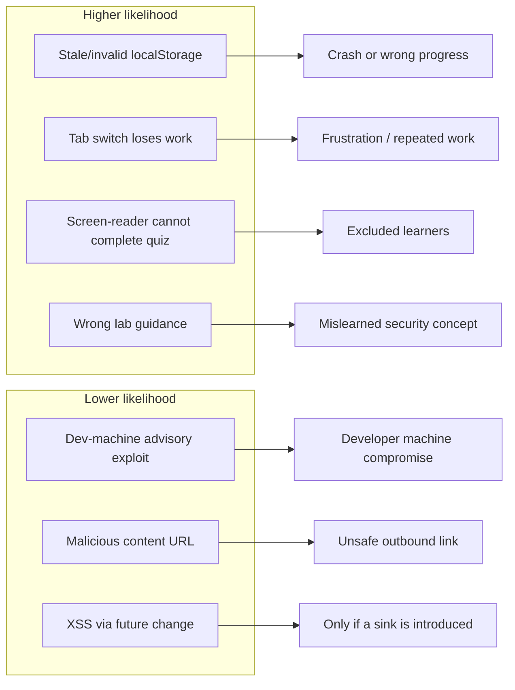

| Risk | Likelihood | Impact | Mitigation |
|---|---|---|---|
| Corrupt/blocked localStorage breaks app | Medium | Medium | Safe adapter + schema validation (R3) |
| User loses quiz/tool work | High | Low–Medium | Preserve state or warn (R7) |
| Assistive-tech user cannot complete quizzes | High | High | Programmatic state + labels (R4/R5) |
| Learner misled by lab copy | Low | Low–Medium | Fix chmod condition + tests (R1) |
| Dev-server advisory exploited | Low–Medium | Medium–High | Upgrade Vite/esbuild (R2) |
| Client-side score forgery | High | Low (no credentials) | Treat as cache; server-side if credentialed |
| Future XSS regression | Low | High | Keep escaping; add CSP; lint/a11y CI |

**No CRITICAL risk** exists today because there is no backend, no secrets, no auth, and no unsafe HTML sink.

---

## 15. Evaluation scorecard

Scale: 1 = critical deficiencies, 5 = excellent.

| Area | Score | Justification |
|---|---:|---|
| Architecture | 4.0 | Clear, right-sized, no cycles; some coupling and eager loading |
| Component design | 3.0 | Good reusability in quiz/diagram; god modules and duplication |
| Routing | 3.5 | Simple and deep-linkable; no 404, weak id validation |
| State management | 3.0 | Correct core updates; monolithic context; unguarded persistence |
| Type safety | 4.0 | Strict and clean; tests excluded; a few casts |
| Security | 4.0 | No XSS/secrets/network; dev advisories and no CSP |
| Privacy | 5.0 | No data leaves the device |
| Performance | 3.0 | No assets, but large bundle and broad rerenders |
| Accessibility | 2.0 | Semantic base; core controls and contrast fail |
| Testing | 3.0 | Excellent content/SSR; no behavior coverage |
| Design system | 3.0 | Consistent but not systematized |
| Documentation | 3.0 | Useful, but several claims overstate reality |
| **Overall** | **3.4 / 5** | Solid static course; needs accessibility and verification work |

## 16. Improvement roadmap

**Constraint:** all items are frontend-only unless explicitly marked otherwise. Nothing here requires inventing backend behavior.

### 16.1 Prioritization model

| Priority | Meaning | Target window | Criteria |
|---|---|---|---|
| **P0 — Immediate** | Correctness/security defect that teaches wrong behavior or blocks a core user task | 0–1 week | High user impact or safety/education risk; small, contained fix |
| **P1 — Short-term** | Significant UX, accessibility, or verification gap | 2–4 weeks | Core controls unusable by assistive tech, or change cannot be safely made |
| **P2 — Medium-term** | Structural improvement to maintainability/performance | 1–3 months | Reduces recurring cost; enables future features |
| **P3 — Long-term** | Strategic/optional | 3+ months | Nice-to-have, scaling, or platform decisions |

**Severity vs priority:** severity measures risk/impact; priority measures execution order. P0 contains the two small, safe fixes that reduce immediate risk (dev-tooling upgrade and storage hardening). The higher-effort HIGH-severity accessibility work is staged as P1 with explicit acceptance criteria.

### 16.2 Summary board

| ID | Priority | Type | Title | Findings closed |
|---|---|---|---|---|
| R2 | **P0** | Dev security | Upgrade Vite/esbuild and refresh lockfile | H1, SEC1 |
| R3 | **P0** | Reliability | Guard localStorage access and validate progress | M1, SEC3, S1, S2 |
| R1 | **P1** | Correctness | Fix chmod “everyone can read” condition | L1, SEC2, C2 |
| R4 | **P1** | Accessibility | Make quiz/tick-off/toggle state programmatic | H2, A1, C1 |
| R5 | **P1** | Accessibility | Label inputs, add focus-visible and skip link | A2, A3, D7 |
| R6 | **P1** | Correctness | Make exam pool/options variable and reshuffle on retry | M4 |
| R7 | **P1** | UX | Preserve in-progress quiz/tool state across tabs | M3, C3, S3 |
| R8 | **P1** | Resilience | Add error boundary + real 404 + integer route ids | M2 |
| R9 | **P1** | Verification | Add interaction/unit tests, fix test type-checking | M7, T1–T4 |
| R10 | **P1** | Process | Add lint/format/CI and npm scripts | M8, Q4, T6, T7 |
| R11 | **P2** | Design system | Introduce tokens and shared UI primitives | M12, D1, D5, D6, C4–C6 |
| R12 | **P2** | Performance | Split contexts; reduce rerenders and repeated derivation | M6, P2, P3, S4 |
| R13 | **P2** | Accessibility | Fix contrast, mobile overflow, and localization gaps | M9, M10, M11, A4–A8, D2–D4 |
| R14 | **P2** | Performance | Offer a code-split web build alongside single-file | M5, P1 |
| R15 | **P3** | Strategy | Persistence/cross-tab/export, content pipeline, E2E+a11y CI | S5–S8, T5, P4–P6 |

### 16.3 P0 — Immediate actions

#### R2 — Upgrade Vite/esbuild and refresh the lockfile

**Problem.** `npm audit` reports 2 dev vulnerabilities (1 high, 1 low) affecting the Vite dev server and esbuild on Windows. `package.json:25` pins `vite@7.3.2`; the fix is ≥7.3.8.

**Actions**

1. Upgrade to `vite@^7.3.8` (or latest 7.x) and refresh `package-lock.json`.
2. Re-run `npm audit`; confirm 0 vulnerabilities, including dev.
3. Re-run `npx tsc --noEmit`, tests, and a real `npm run build`.
4. Verify the dev server still works with the Tailwind and single-file plugins.
5. Add `npm audit` (or Dependabot/Renovate) to CI.

**Acceptance criteria:** `npm audit` reports 0 vulnerabilities; `npm run build` succeeds and produces the single-file artifact; `npx vitest run` still passes 154/154 (or the updated count); no production dependency was added.

**Note.** This does not affect the shipped static bundle, but it protects maintainers’ Windows machines. Document that distinction in the PR.

#### R3 — Guard localStorage and validate persisted progress

**Problem.** `store.tsx:44` reads localStorage unguarded during initialization; `47-54` writes unguarded. A `SecurityError`, quota error, or malformed-but-valid-JSON progress object can crash rendering (`88-96`).

**Actions**

1. Create `src/lib/storage.ts` with `safeGet`, `safeSet`, `safeRemove` wrapped in try/catch and a memory fallback.
2. Add a `parseProgress(raw): Progress` type guard:
   - accept only plain objects;
   - validate `read` as a boolean map;
   - validate `lab`/`hw` as arrays of booleans;
   - validate `quiz` entries as `{score:number,total:number}` with `total > 0`, `0 ≤ score ≤ total`;
   - validate `exam` the same way;
   - drop unknown keys and outliers.
3. Add a schema version (`v1`, or bump to `v2`) and migrate or discard old shapes.
4. Clamp stored arrays to current content lengths in `status()` and guard zero-length denominators.
5. Initialize language through the safe adapter too.

**Acceptance criteria:** app renders with no localStorage, throwing localStorage, `"null"`, `"[]"`, `{"read":null}`, negative scores, and arrays longer than content; corrupt data resets to `EMPTY` without a crash or console error; valid data round-trips; tests cover all cases with injected storage failures.

**Files:** `src/store.tsx:33-54,88-96`, new `src/lib/storage.ts`, new `tests/unit/store.test.ts`.

### 16.4 P1 — Short-term actions

#### R1 — Fix the chmod “everyone can read” condition

**Problem.** `PermTool` lays bits out row-major as `[owner r,w,x, group r,w,x, others r,w,x]` (`LabToolsA.tsx:110,113,125-126`), so indices 0–2 are owner, 3–5 group, and 6–8 others. The world-writable check on `b[7]` (`115`) is therefore **correct**. The defect is the fallback branch: `b[6] && b[0]` claims “Everyone can read it” while ignoring group-read `b[3]`. For example, `chmod 604` (owner `rw-`, group `---`, others `r--`) triggers the message even though the group cannot read.

Secondary issue: permission checkboxes have no accessible names (`125-127`); covered by R5.

**Actions**

1. Change the condition to `b[0] && b[3] && b[6]`.
2. Extract bit → octal/symbolic/warning calculation into `src/lib/permissions.ts` as a pure function.
3. Keep the red-text condition tied to world-writable (`b[7]`); optionally add a distinct group-writable hint on `b[4]`.
4. Add unit tests for representative octals.

**Acceptance criteria:** `chmod 777` → world-writable warning; `770` → no world-writable warning; `444` → “everyone can read”; `640` → “looks reasonable”; `604` → **not** “everyone can read”; octal and symbolic output correct across all 512 combinations; extracted function covered by tests.

**Effort:** ~0.5 day. **Files:** `src/components/LabToolsA.tsx:107-139`, new `src/lib/permissions.ts`, new `tests/unit/permissions.test.ts`.

#### R4 — Make selection state programmatic

**Problem.** Quiz options, lesson/lab/homework tick-offs, phishing selections, and toggle buttons express state only through color/class. Screen-reader users cannot tell what is selected or correct (`QuizRunner.tsx:42-64`, `SessionView.tsx:59-65`, `LabToolsA.tsx:85-96,11-21`).

**Actions**

1. Quiz: use native `<input type="radio">` inside `<fieldset><legend>` per question, or `role="radiogroup"` + `role="radio"` + `aria-checked`. Keep the visual card styling via `peer`/labels.
2. `Check`: add `role="checkbox"` + `aria-checked` (or use a native checkbox) and keep button styling.
3. Phishing/RBAC/firewall toggles: add `aria-pressed`; ensure text or icon also conveys state.
4. Add `aria-live="polite"` (`role="status"`) for score/result summaries.
5. Ensure focus stays logical after submit/retry.

**Acceptance criteria:** keyboard-only user can complete a quiz, including arrow-key movement within a question group; screen reader announces selected option and checked/unchecked tick-offs; axe-core reports no “ARIA state” or “form control has no name” violations on these components; visual design unchanged or improved.

#### R5 — Labels, focus visibility, skip link

**Problem.** Inputs rely on placeholders or English `aria-label`; `outline-none` removes native focus rings; no skip link; focus is not moved on route change (`Pages.tsx:96`; `LabToolsA.tsx:22,221`; `LabToolsB.tsx:47-65,99,171-172,264`; `App.tsx`).

**Actions**

1. Wrap every input in a `<label>` or add `aria-labelledby`; localize labels.
2. Replace `outline-none` with `focus-visible:ring-2 focus-visible:ring-emerald-400 focus-visible:ring-offset-2 focus-visible:ring-offset-slate-950`.
3. Add a “Skip to content” link as the first focusable element targeting `<main id="main">`.
4. On route change, focus the page `<h1>`/`<h2>` (`tabIndex={-1}`) and optionally announce via a visually hidden live region.
5. Add `aria-current="page"` to active nav and session tabs.

**Acceptance criteria:** every form control has an accessible name in both languages; focus is clearly visible on all interactive elements at 3:1 contrast; skip link appears on first Tab and works; route change moves focus to the new heading and announces it.

#### R6 — Vary the exam

**Problem.** `Pages.tsx:116` always selects quiz indices `[1,3]`, so every exam is the same 40 questions in shuffled order; options are never shuffled.

**Actions**

1. Build the pool from **all** quiz questions (139) and sample 40 per attempt.
2. Shuffle option order per question at attempt creation (store the permutation with the question).
3. Use a better seed/PRNG or `crypto.getRandomValues()` where available.
4. Recompute on “Try again”, not only on route re-entry.
5. Show prior best score/pass status on the intro screen.

**Acceptance criteria:** two consecutive attempts differ in question membership; option order varies between attempts; scoring uses the stored permutation; tests assert pool size, uniqueness, full-pool membership, and stable scoring.

#### R7 — Preserve in-progress work across tabs

**Problem.** Tab bodies are conditionally mounted (`SessionView.tsx:99-160`); switching tabs unmounts `QuizRunner` and tools, silently discarding answers and selections.

**Actions**

1. Lift quiz answers/submitted state to `SessionView` or a per-session store keyed by session id.
2. Keep tool state mounted with CSS hiding (`hidden`) instead of unmounting, or persist tool state in a session-scoped store.
3. If state cannot be preserved, show a confirmation before leaving a dirty quiz.
4. Persist unsubmitted quiz answers per session in sessionStorage (not localStorage) as a pragmatic fallback.

**Acceptance criteria:** select answers → switch to Lab → return: answers remain; configure a tool → switch tabs → return: configuration remains (or a clear warning was shown); submitted results and best scores still behave correctly.

#### R8 — Error boundary and real 404

**Problem.** No error boundary; unknown routes silently render Home without changing the URL; fractional ids reach a dead “Session not found.” branch (`App.tsx:29-36`; `router.ts:19-25`; `SessionView.tsx:71`).

**Actions**

1. Add an `ErrorBoundary` around the route outlet with a localized fallback and “Reload” action.
2. Add `{page:"notFound"}` to `Route`; render a 404 page with links home/sessions.
3. Require `Number.isInteger(id)` and validate against `SESSIONS` ids.
4. Replace `PHASES.find(...)!` with a safe fallback.
5. Optionally normalize invalid URLs via `history.replaceState`.

**Acceptance criteria:** unknown hash shows a 404 page and preserves the URL; `#/session/5.5`, `#/session/0`, `#/session/21` show 404, not Home or a crash; a thrown render error shows the fallback instead of a blank screen; no non-null assertions remain in route/session resolution.

#### R9 — Test the behavior that matters

**Problem.** 154 tests cover content and SSR only; no interaction, store, router-hook, or tool logic tests. Tests are excluded from `tsc` (`tsconfig.json:30`).

**Actions**

1. Add `jsdom`, `@testing-library/react`, `@testing-library/user-event`, `@testing-library/jest-dom`.
2. Add `tsconfig.test.json` including `tests/`; run it in CI.
3. Unit-test extracted pure helpers: permissions, CIDR, firewall, log parser, risk rating, order/match, exam sampling.
4. Unit-test store transitions with an injectable storage adapter.
5. Component-test `QuizRunner` (select → submit → score → retry) and `Check`.
6. Test `parse()` edge cases and `useRoute` with simulated `hashchange`.
7. Add `@vitest/coverage-v8` with initial thresholds and ratchet.

**Acceptance criteria:** tests fail if the chmod bug is reintroduced; store tests cover best-score retention, reset, and malformed storage; quiz tests cover submit gating, scoring, and retry; `tsc -p tsconfig.test.json` passes; coverage baseline recorded and enforced.

#### R10 — Add lint, format, CI, and scripts

**Problem.** No ESLint/Prettier, no CI, no `test`/`typecheck` scripts (`package.json:6-10`).

**Actions**

1. Add ESLint (typescript-eslint, react-hooks, jsx-a11y) and Prettier with a shared config.
2. Add scripts: `dev`, `build`, `preview`, `test`, `test:watch`, `typecheck`, `lint`, `format`, `audit`, `verify`.
3. Add a CI workflow: install → typecheck → lint → test → build → audit.
4. Enable `jsx-a11y` rules to prevent regressions in R4/R5.

**Acceptance criteria:** `npm run verify` passes locally and in CI; CI runs on every push/PR; the build artifact is produced in CI; no lint errors and warnings are triaged.

### 16.5 P2 — Medium-term actions

#### R11 — Design tokens and shared primitives

1. Add semantic tokens with Tailwind v4 `@theme` (surface, accent, muted, radius, Arabic font).
2. Create `components/ui/`: `Button`, `Card`, `Input/Field`, `Badge`, `Callout`, `ProgressBar`, `DataTable`, `LabShell`, `ResultBadge`.
3. Adopt `cn` (`clsx` + `tailwind-merge`) or remove both dependencies.
4. Move `Box`/`Btn`/`inp` out of `LabToolsA` into `ui/`.
5. Standardize table wrappers and captions.
6. Document usage and variants.

**Acceptance criteria:** no repeated card/button class strings outside `ui/`; `LabToolsA`/`LabToolsB` contain tools only; visual regression screenshots unchanged except intended fixes; `cn` is either used or removed with its dependencies.

#### R12 — Split context and reduce rerenders

1. Split `LanguageContext` and `ProgressContext`; expose `useLang()` and `useProgress()`.
2. Provide a selector or `useSyncExternalStore`-style subscription for high-frequency progress.
3. Memoize `SectionView`, `Diagram`, and session cards; stabilize callbacks.
4. Precompute a `statusMap` once per progress change; reuse in Home and SessionList.
5. Debounce localStorage writes.
6. Remove the unnecessary `useCallback` on `setLang` or keep it only if value identity matters.

**Acceptance criteria:** clicking a checkbox does not rerender `SectionView`/`Diagram`; Home computes `status()` at most 20 times per progress change; profiling shows no regression; no behavior change.

#### R13 — Contrast, mobile overflow, and full localization

1. Replace `text-slate-500` small text with `slate-400` (or larger/bolder) — 11 px metadata and glossary links.
2. Wrap firewall and log tables in `overflow-x-auto`; add `flex-wrap` to the session footer.
3. Increase mobile touch targets to ≥44 px.
4. Localize remaining chrome: eyebrow, `~22h`, table headers, placeholders, aria labels, document title.
5. Add `lang="en"` to inline English in Arabic mode; add RTL-aware arrows.
6. Hide decorative emoji with `aria-hidden` or replace with meaningful icons.
7. Fix Home `<dd>`/`<dt>` order.
8. Add reduced-motion guards.

**Acceptance criteria:** all text meets WCAG 2.2 AA contrast (axe + manual check); no horizontal page overflow at 320 px in EN or AR; no untranslated UI chrome in Arabic mode; document title reflects route and language; mobile Lighthouse accessibility ≥95.

#### R14 — Code-split web build

1. Keep `vite-plugin-singlefile` as the default/offline build.
2. Add a second build mode (env flag) without single-file for web hosting.
3. Lazy-load lab tools per tool and session bodies per session where beneficial.
4. Consider extracting glossary/term index from full sessions.
5. Inline the page background color to avoid a white flash.

**Acceptance criteria:** web build has route/session-level chunks and an initial JS budget (e.g., <250 KB gzip); offline single-file build still works from `file://`; both builds pass tests and smoke checks; bundle report recorded per build.

### 16.6 P3 — Long-term / strategic

#### R15 — Platform and quality investments

| Item | Rationale | Acceptance |
|---|---|---|
| Cross-tab sync via `storage` events | Avoid silent last-write-wins | Two tabs converge; best scores merge |
| Per-session reset + export/import JSON | Learner control, portability | Export round-trips; reset scoped |
| E2E suite (Playwright) | Verify real browser behavior | Deep links, quiz, exam, persistence, RTL, mobile |
| axe + visual regression in CI | Prevent a11y/UI regressions | Failing axe/screenshot blocks merge |
| Scheduled link checker | 85 external refs | Report published; broken links triaged |
| Content QA workflow | Tests cannot judge accuracy/Arabic | Review checklist per release |
| Certificate/grade integrity | If credentials are offered | Server-side identity + scoring; do not fake it client-side |
| PWA/offline (optional) | Single-file already offline-capable | Document tradeoffs before adding SW |
| Document title/route metadata | Navigation and sharing | Title updates per route/language |
| ADRs for state, routing, build | Onboarding | Short records in `docs/adr/` |

### 16.7 Sequencing and dependencies

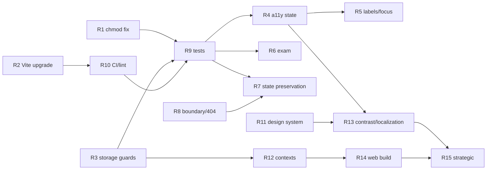

**Suggested order**

1. **Week 0–1:** R2, R3 (small, high value, unblock safe iteration).
2. **Week 1–2:** R10, then R9, with R1 folded into the first test batch (verification before behavioral changes).
3. **Week 2–4:** R4, R5, R6, R7, R8 (user-facing correctness/accessibility).
4. **Month 2–3:** R11, R12, R13, R14.
5. **Quarter 2+:** R15.

**Do R9/R10 early** even though they are labeled P1: without tests and CI, R4/R6/R7 carry regression risk.

### 16.8 Effort estimates

| ID | Effort | Risk of change | Confidence |
|---|---|---|---|
| R1 | 0.5 day | Low | High |
| R2 | 0.5 day | Low | High |
| R3 | 1–2 days | Medium | High |
| R4 | 3–5 days | Medium | High |
| R5 | 2–3 days | Low | High |
| R6 | 1–2 days | Medium | High |
| R7 | 2–4 days | Medium | Medium |
| R8 | 1–2 days | Low | High |
| R9 | 4–7 days | Low | High |
| R10 | 1–2 days | Low | High |
| R11 | 5–10 days | Medium | Medium |
| R12 | 2–4 days | Medium | High |
| R13 | 3–5 days | Low | High |
| R14 | 3–6 days | Medium | Medium |
| R15 | Ongoing | Varies | Low–Medium |

Estimates assume one experienced frontend engineer familiar with the codebase. They exclude content review and translation work.

### 16.9 Definition of done (global)

A roadmap item is done only when:

1. The change is implemented and reviewed.
2. New/updated tests fail before and pass after (where applicable).
3. `npm run verify` (typecheck, lint, tests, build, audit) passes in CI.
4. Accessibility-affecting changes pass axe checks and a keyboard walkthrough.
5. Both English and Arabic are checked at 320/768/1280 px.
6. Documentation (`README`, string lists, ADRs) is updated.
7. No production secrets, network calls, or backend assumptions were introduced.

### 16.10 What not to do

- **Do not** add a backend just to “modernize” a static course; only do it if certificates/grades or multi-device sync become real requirements — and then design identity/authorization properly.
- **Do not** replace the small router with a heavy framework without a concrete need; fix its edge cases instead.
- **Do not** add `dangerouslySetInnerHTML` or an HTML-rendering markdown pipeline; the current escaped-text model is a security strength.
- **Do not** remove the single-file build; add a web build alongside it.
- **Do not** treat frontend progress checks as authorization; they are UX only.
- **Do not** “fix” accessibility by adding ARIA where native semantics (radio, checkbox, label) are simpler and safer.

## 17. Appendices

### 17.1 Content metrics

| Metric | Value |
|---|---:|
| Sessions | 20 |
| Phases | 5 (4/4/4/5/3) |
| Sections | 81 |
| Objectives | 80 |
| Lab steps | 112 |
| Quiz questions | 139 |
| Homework tasks | 81 |
| References | 85 |
| Terms | 150 (148 unique English) |
| Declared minutes | 1,290 |
| Diagram kinds | flow 8, cycle 5, grid 4, layers 3 |

### 17.2 Code metrics

| Metric | Value |
|---|---:|
| Source files (`src/`) | 26 |
| Test files | 2 |
| Source lines (`src/` + `tests/`) | ~3,050 |
| Largest code module | `LabToolsA.tsx` (372) |
| React components | 33 |
| `any` in `src/` | 0 |
| Non-null assertions | 2 |
| Runtime dependencies | 4 (2 unused) |
| Tests passing | 154 |

### 17.3 Quality gates

| Gate | Result |
|---|---|
| `npx tsc --noEmit` | Pass |
| `npx vitest run` | 154/154 pass |
| `npm audit --omit=dev` | 0 vulnerabilities |
| `npm audit` | 2 dev vulnerabilities |
| Lint | Not configured |
| Format | Not configured |
| CI | Not configured |
| Build executed | No (audit avoided writing artifacts) |

### 17.4 Contrast reference

| Pair | Ratio | AA |
|---|---:|---|
| `slate-500` / `slate-900` | 3.75:1 | Fail |
| `slate-500` / `slate-950` | 4.24:1 | Fail |
| `slate-400` / `slate-900` | 6.96:1 | Pass |
| `slate-400` / `slate-950` | 7.87:1 | Pass |
| `slate-300` / `slate-950` | 13.59:1 | Pass |
| `emerald-400` / `slate-950` | 10.49:1 | Pass |
| `amber-400` / `slate-950` | 12.08:1 | Pass |
| `red-400` / `slate-950` | 7.29:1 | Pass |

### 17.5 Key file evidence index

| Claim | Evidence |
|---|---|
| React mount + StrictMode | `src/main.tsx:6-10` |
| Provider wraps shell | `src/App.tsx:42-48` |
| Route outlet + not-found | `src/App.tsx:29-36` |
| Active nav | `src/App.tsx:11-16,23` |
| Hash parser / range / tab | `src/router.ts:13-26` |
| Hash subscription + cleanup | `src/router.ts:36-47` |
| Progress model | `src/store.tsx:4-10` |
| Unguarded language read | `src/store.tsx:44` |
| Unguarded writes | `src/store.tsx:47-54` |
| Best-score retention | `src/store.tsx:73-80` |
| Completion formula | `src/store.tsx:88-96` |
| Eager content imports | `src/content/index.ts:2-13` |
| Tool union | `src/content/types.ts:24-39` |
| Quiz options as buttons | `src/components/QuizRunner.tsx:42-64` |
| Submit gating | `src/components/QuizRunner.tsx:81` |
| Tick-off control | `src/components/SessionView.tsx:59-65` |
| Tab bodies conditionally mounted | `src/components/SessionView.tsx:99-160` |
| Hardcoded `/20` | `src/components/SessionView.tsx:81` |
| Non-null phase assertion | `src/components/SessionView.tsx:71` |
| Fixed exam indices | `src/components/Pages.tsx:116` |
| Exam seed | `src/components/Pages.tsx:117-120,128` |
| chmod bit layout | `src/components/LabToolsA.tsx:110,113,125-126` |
| chmod warning condition | `src/components/LabToolsA.tsx:115` |
| Unlabeled perm checkboxes | `src/components/LabToolsA.tsx:125-127` |
| Firewall table | `src/components/LabToolsA.tsx:272-289` |
| Log table | `src/components/LabToolsB.tsx:267-280` |
| External link hardening | `src/components/SessionView.tsx:155` |
| Single-file plugin | `vite.config.ts:13` |
| Strict TS | `tsconfig.json:25-28` |
| Tests excluded from TS | `tsconfig.json:30` |
| Missing scripts | `package.json:6-10` |
| Vite pin | `package.json:25` |
| Unused deps | `package.json:12,15`; `src/utils/cn.ts` |
| Dead helper | `src/utils/cn.ts:1-6` (no importers) |
| Static title | `index.html:6` |

### 17.6 Verification commands

```text
$ npx tsc --noEmit
(exit 0, no output)

$ npx vitest run
Test Files  2 passed (2)
Tests       154 passed (154)
Start at    10:29:21
Duration    2.81s (transform 1.58s, setup 0ms, import 2.14s, tests 1.32s, environment 1ms)

$ npm audit --omit=dev
found 0 vulnerabilities

$ npm audit
2 vulnerabilities (1 low, 1 high)
```

### 17.7 Severity and confidence conventions

- **CRITICAL** — remote compromise, data loss, or a broken security boundary.
- **HIGH** — major user or security impact; core task blocked or meaningful risk.
- **MEDIUM** — significant quality, usability, or resilience risk.
- **LOW** — minor polish or localized correctness issue.
- **INFO** — observation, strength, or non-actionable context.
- Confidence is **high** where a finding is directly evidenced in source and reproduced by a command; **medium** where it depends on runtime/browser behavior; **low** where it depends on external content or unmeasured performance.
- Severity ratings are contextual professional judgments based on impact and likelihood in this application, not CVSS scores.

---

## 18. Limitations and conclusion

### 18.1 Limitations and disclaimer

- This is a **static, evidence-based audit**. It does not replace runtime browser testing, manual accessibility testing with real assistive technology, penetration testing, or content fact-checking.
- Bundle figures are **esbuild estimates**, not a signed `vite build` artifact; CSS and final inline HTML size were not measured.
- Dependency advisories reflect the local registry state on 2026-11-12 and can change.
- External reference liveness and safety were not tested.
- No backend behavior was inferred; where no API/auth exists, this report says so explicitly.
- Severity ratings are contextual professional judgments based on impact and likelihood, not CVSS scores.
- Line numbers refer to the audited revision and may drift after remediation.
- Static review cannot prove the absence of all runtime XSS; no browser fuzzing or CSP testing was performed.
- No penetration test, SAST, DAST, or dependency SBOM analysis was run.
- No backend exists, so server-side authorization, session management, and API security are out of scope by definition.

### 18.2 Audit conclusion

The project is a **well-scoped, privacy-preserving, content-strong static course** whose architecture fits its delivery model. It does not need a backend, a heavier router, or a state library to meet its current goals.

It does need a focused round of **accessibility and verification work**, plus two small safety fixes: upgrade the dev toolchain and harden localStorage. The highest pedagogical risk is not architectural but human: learners using assistive technology cannot fully operate the core assessments, and a small permission-warning condition can mislabel `chmod 604`.

With the P0 and P1 roadmap items completed, the app would move from “adequate” to “solid” across every dimension without changing its fundamental design.

**No application source, tests, or configuration files were modified during this audit.**

## 19. Remediation status (2026-11-12)

The findings above were implemented after the read-only audit. This section records what changed.

| Item | Status | Evidence |
|---|---|---|
| R1 — chmod condition | Fixed | `src/lib/permissions.ts`; `b[0] && b[3] && b[6]`; `tests/unit/permissions.test.ts` covers 444/604/640/770/777 and all 512 combinations |
| R2 — dev toolchain | Fixed | `vite@7.3.8`; `npm audit` reports 0 vulnerabilities |
| R3 — storage hardening | Fixed | `src/lib/storage.ts`, `src/lib/progress.ts`; malformed/throwing/absent storage tests |
| R4 — programmatic state | Fixed | Native quiz radios in `fieldset`/`legend`, native checkboxes, `aria-pressed`, `role="status"` results |
| R5 — labels/focus/skip | Fixed | Localized labels, `focus-visible` rings, skip link, `aria-current`, route focus announcement |
| R6 — exam variation | Fixed | `src/lib/exam.ts` samples the full pool, shuffles options, remaps answers, reshuffles on retry |
| R7 — in-progress work | Fixed | All session panels stay mounted with `hidden`; quiz and tool state survive tab changes |
| R8 — 404/boundary | Fixed | `notFound` route, integer ID validation, `ErrorBoundary`, safe phase fallback |
| R9 — verification | Fixed | Unit tests plus jsdom component tests; `tsconfig.test.json`; 182 tests pass |
| R10 — process | Fixed | `lint`, `format`, `test`, `typecheck`, `audit`, `verify` scripts; ESLint + jsx-a11y; CI workflow |
| R11 — primitives | Partial | `src/components/ui.tsx`, design tokens in `src/index.css`; broader migration continues incrementally |
| R12 — rerenders | Fixed | `useLang`/`useProgress` split contexts, memoized sections/diagrams, memoized status maps, debounced writes |
| R13 — contrast/mobile/i18n | Fixed | `slate-500` metadata raised to `slate-400`, table wrappers, larger targets, localized chrome, reduced-motion guard |
| R14 — web build | Fixed | `npm run build` (single file) and `npm run build:web` (hashed chunks in `dist-web/`) |
| R15 — strategic items | Partial | Cross-tab `storage` sync and per-session reset added; export/import, Playwright, axe CI, link checking and content QA remain future work |

Verification run: `npm run typecheck`, `npm run typecheck:test`, `npm run lint`, `npm test`, `npm run build`, `npm run build:web`, and `npm audit` all pass.

